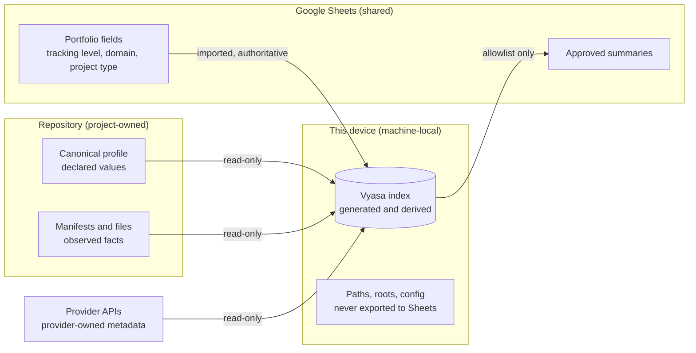

# Diagrams: Data Ownership and Source of Truth

C4 vocabulary: `knowledge/architecture/c4-system-views.md`. The question here is who owns each kind of value and
which way it may flow.

## Who owns what, and what may cross? (data-flow view)

Arrows show the only permitted directions. A scan never writes the repository or the portfolio fields; a sync
never writes declared values or local data.
