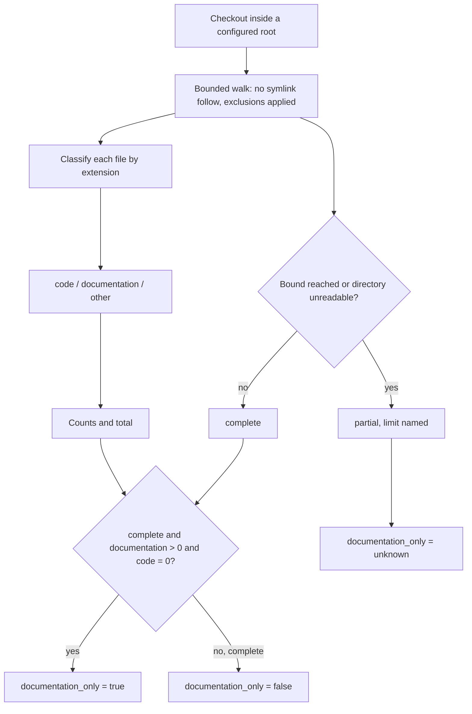
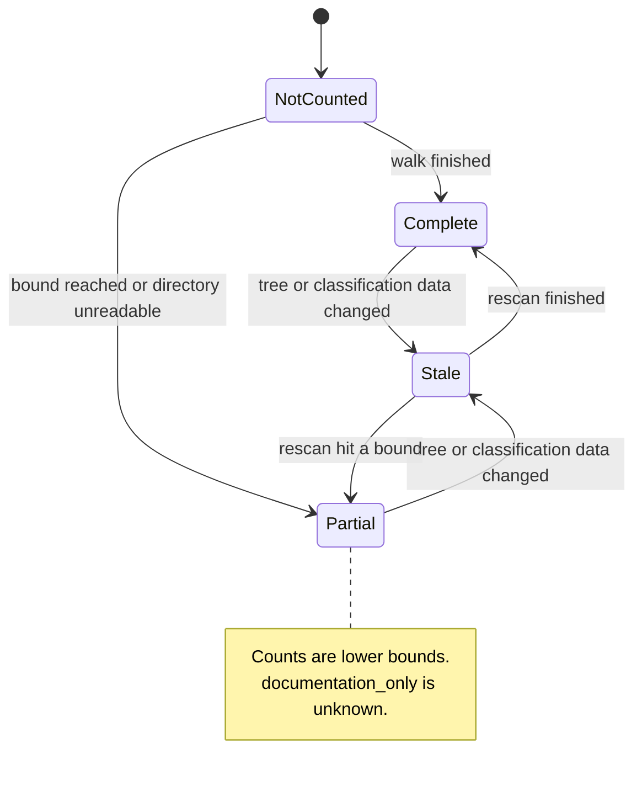

# Diagrams: File Composition

C4 vocabulary: `knowledge/architecture/c4-system-views.md`. The question here is how one walk produces counts, and when a count may be trusted.

## How does one walk become counts and an indicator? (flow)

## When may a count be trusted? (state)

