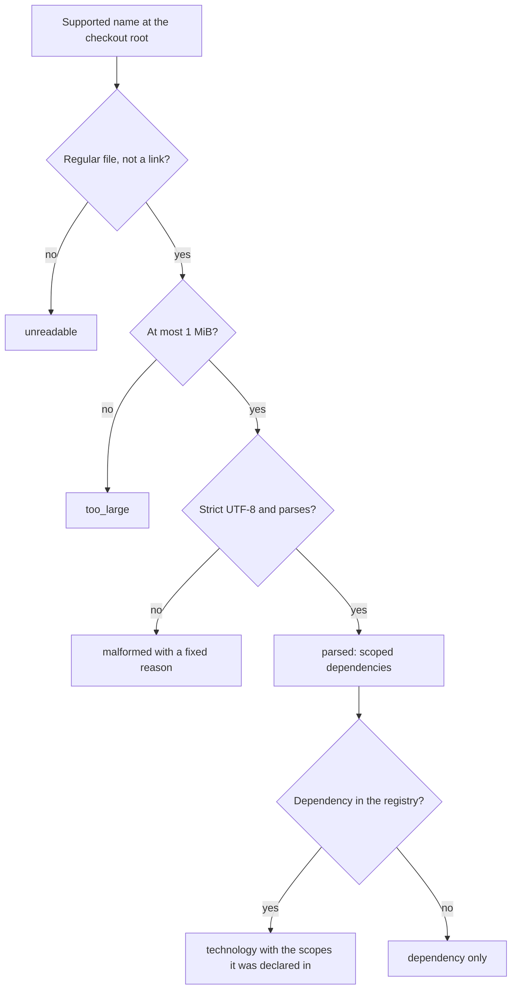
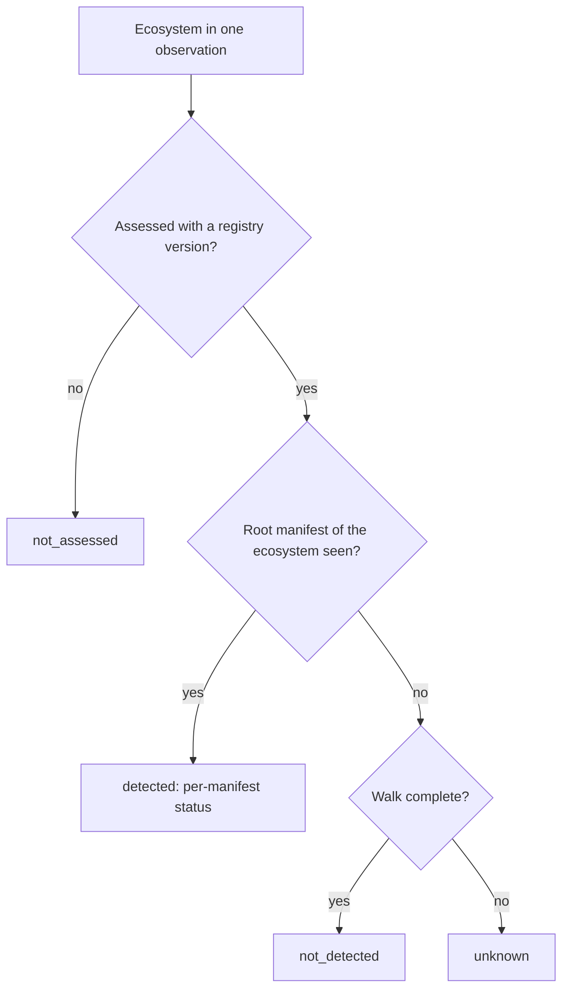

# Diagrams: Framework and Technology Detection

The question here is what may be believed about a manifest read from an untrusted repository.

## How does a root manifest become a technology, or stay unknown? (flow)

## When may an ecosystem be called absent? (decision flow)

