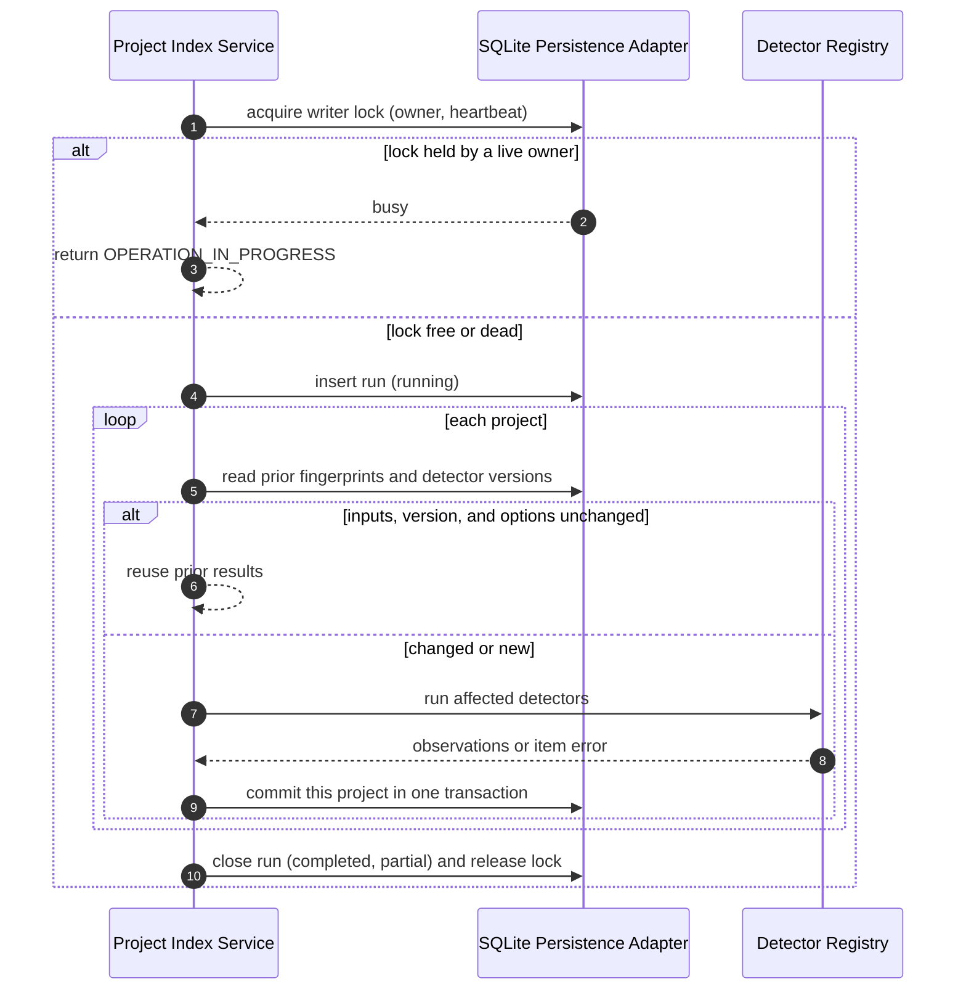
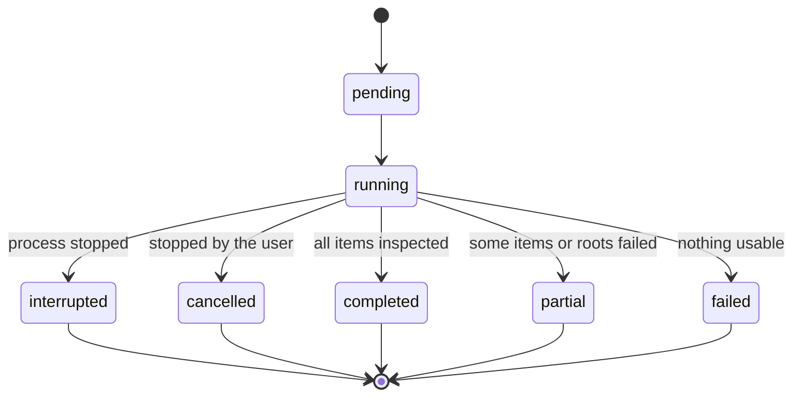

# Diagrams: Local Index and Incremental Refresh

C4 vocabulary: `knowledge/architecture/c4-system-views.md`.

## How does an incremental refresh stay safe? (dynamic view)

## What states can a scan run be in?

