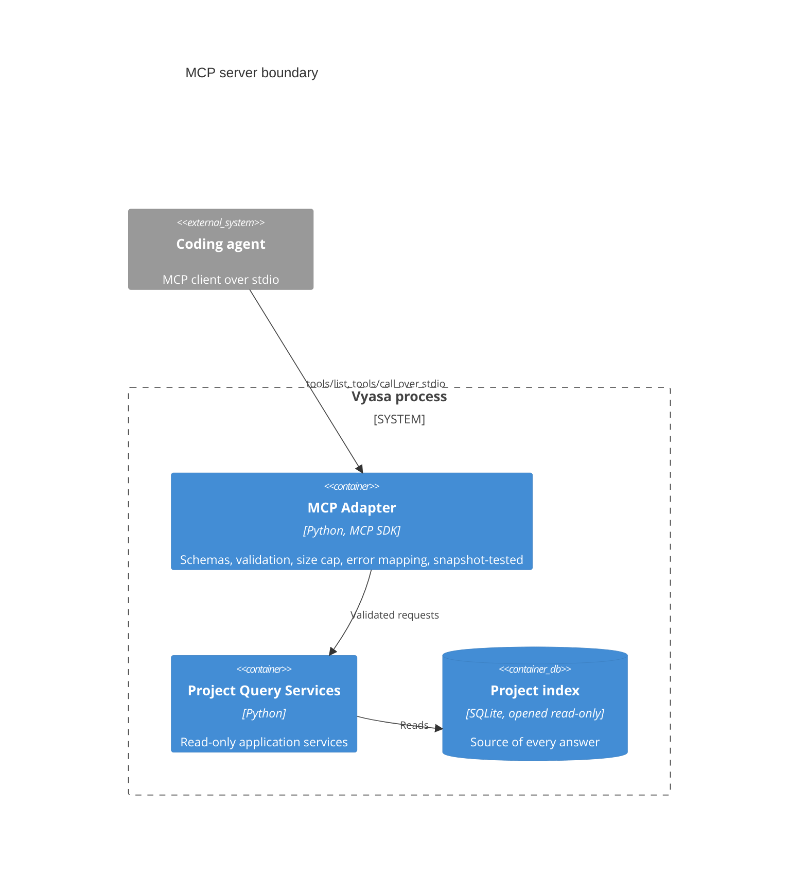

# Diagrams: MCP Server and Tool Contracts

C4 vocabulary: `knowledge/architecture/c4-system-views.md`. The question here is where the protocol boundary sits.

## Where does the protocol end and the application begin? (container view)

The adapter never opens a network listener, never passes a path through, and never writes to stdout except
protocol messages.
