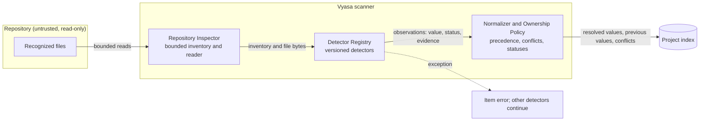

# Diagrams: Metadata Extraction and Evidence

C4 vocabulary: `knowledge/architecture/c4-system-views.md`. This view zooms into the one place where facts are
made, so the rule 'no value without evidence' can be seen as a data flow.

## How does a file become a fact with evidence? (component view)

Every arrow into the index carries a status and an evidence record; there is no path that stores a value
without them.
