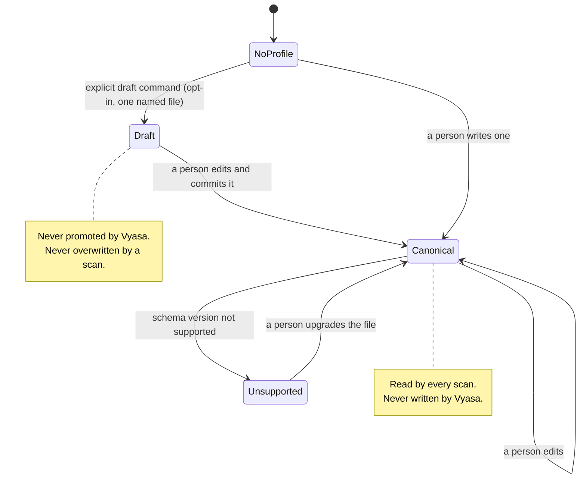

# Diagrams: Project Profile Lifecycle

C4 vocabulary: `knowledge/architecture/c4-system-views.md`. The question here is who may change what, and when.

## How does a profile move from nothing to canonical? (lifecycle)

