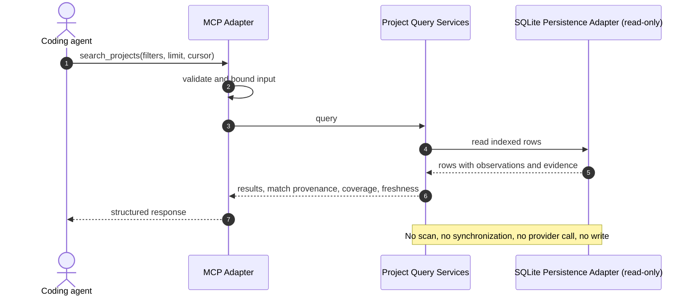
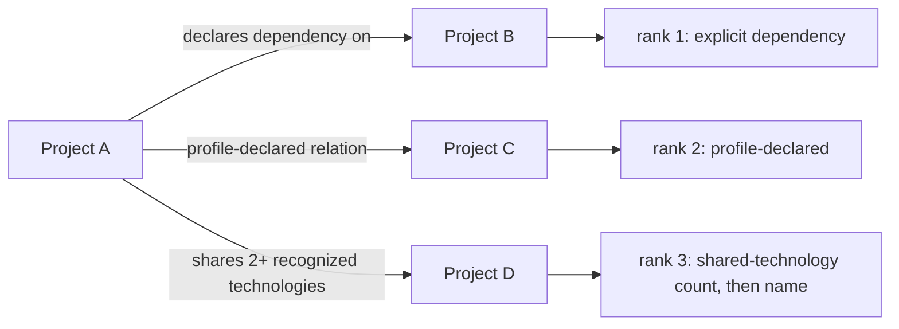

# Diagrams: Project Search, Context, Relations and Dependencies

C4 vocabulary: `knowledge/architecture/c4-system-views.md`.

## What does a query touch? (dynamic view)

## How is a related project explained?

