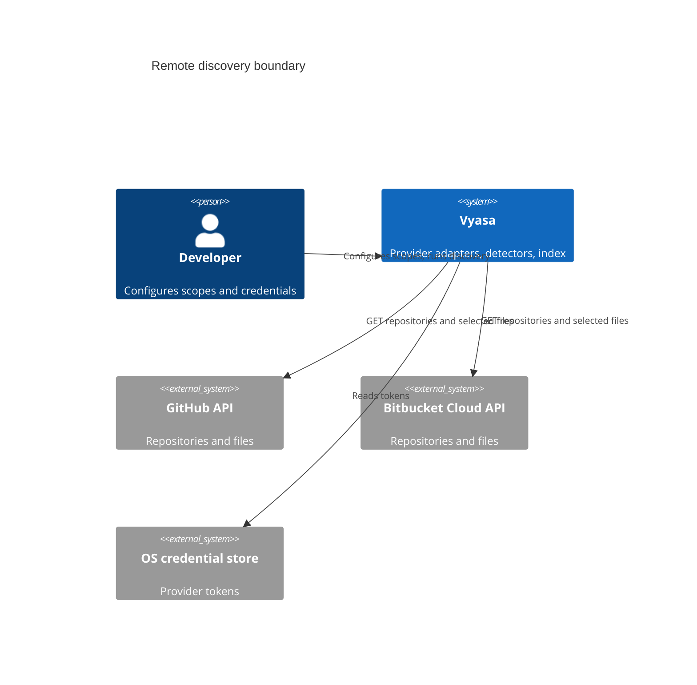
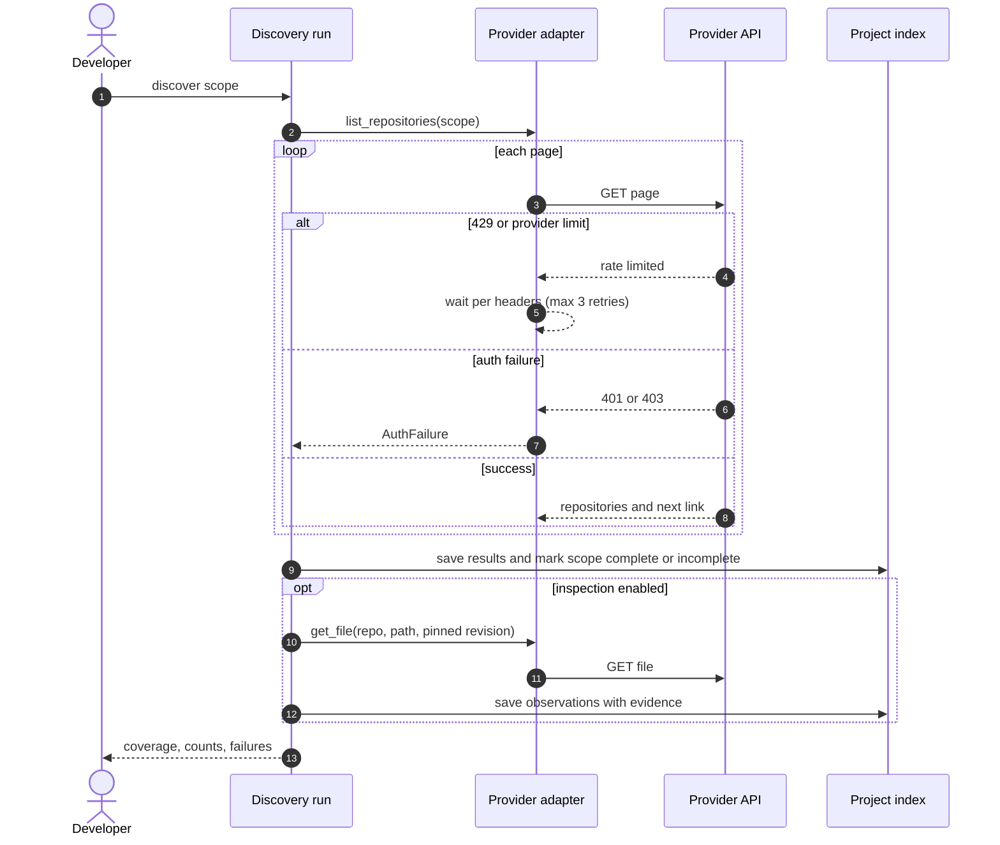

# Diagrams: Remote Repository Discovery and Inspection

C4 vocabulary: `knowledge/architecture/c4-system-views.md`.

## Which external systems are involved? (context view)

## What happens during discovery, including failure? (dynamic view)

