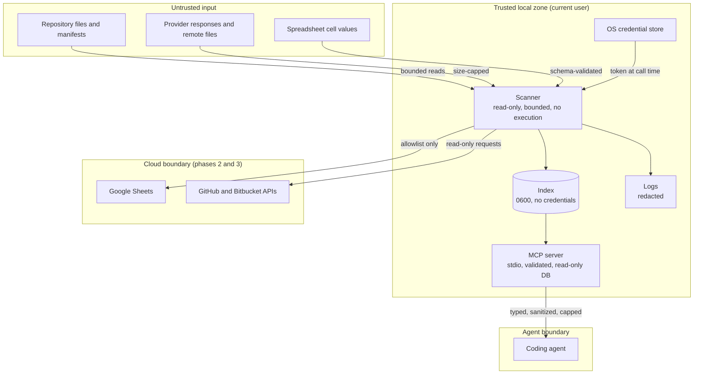

# Diagrams: Security and Privacy

C4 vocabulary: `knowledge/architecture/c4-system-views.md`. The question here is where the trust boundaries lie
and which way data may cross them.

## Where are the trust boundaries? (container view with boundaries)

Everything entering the trusted zone is treated as data. Everything leaving it is minimized, allowlisted, or
sanitized.
