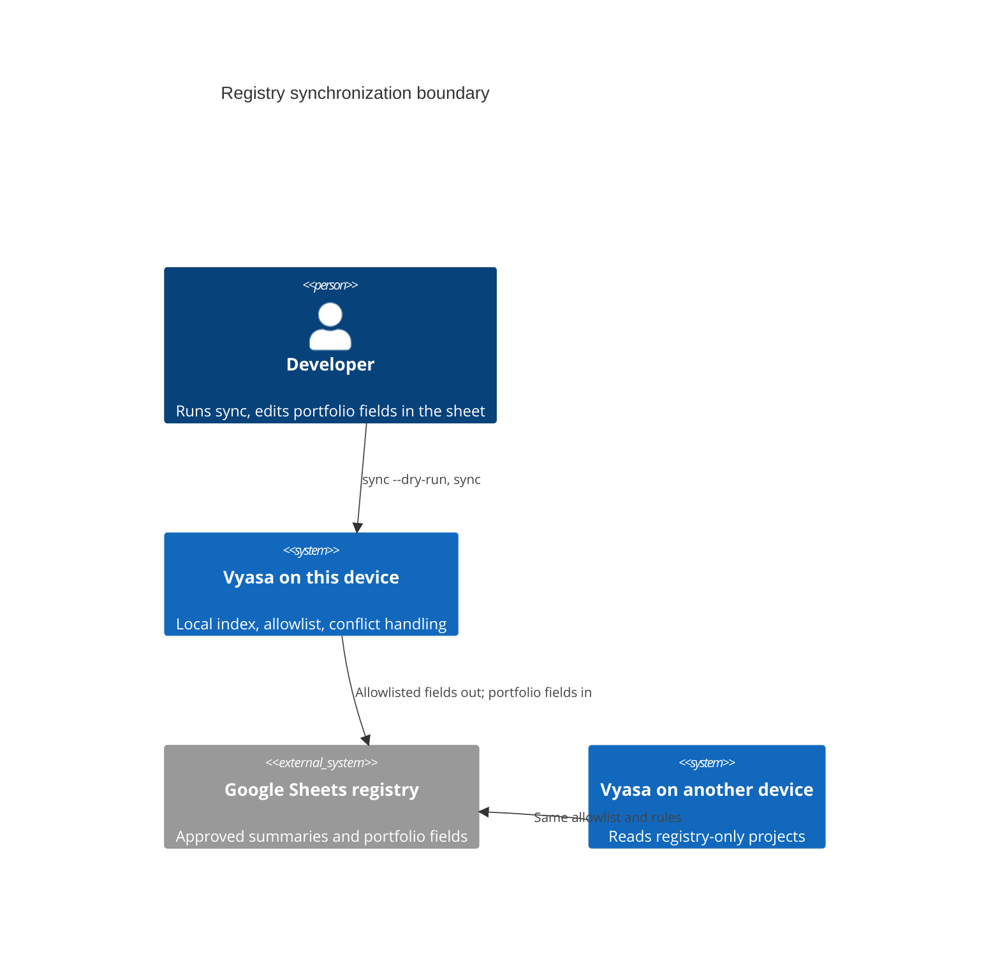
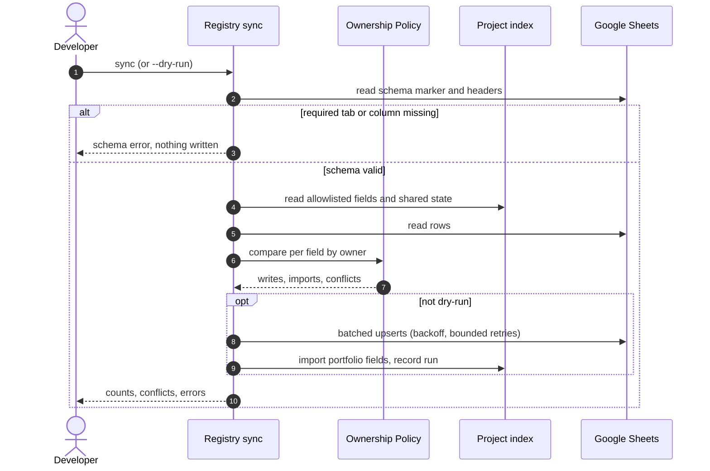

# Diagrams: Shared Registry and Cross-Device Visibility

C4 vocabulary: `knowledge/architecture/c4-system-views.md`.

## Who talks to the registry and what may cross? (context view)

## What happens in one sync run? (dynamic view)

