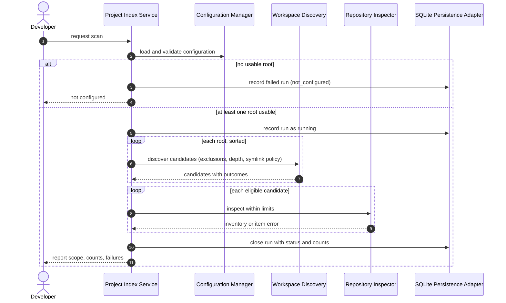
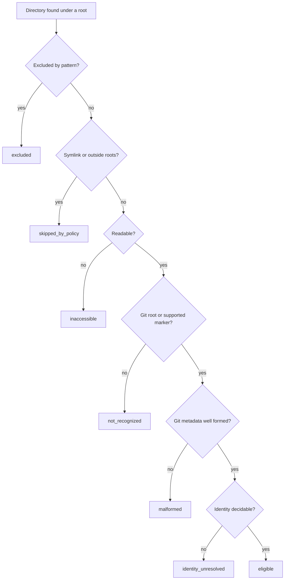

# Diagrams: Workspace Discovery and Scan Reporting

C4 views for the whole system are in `knowledge/architecture/c4-system-views.md`. These two views answer
the questions specific to this package. Mermaid text; not rendered by any tool in this repository.

## What happens during one scan? (dynamic view)

## How does a directory become a candidate outcome?

