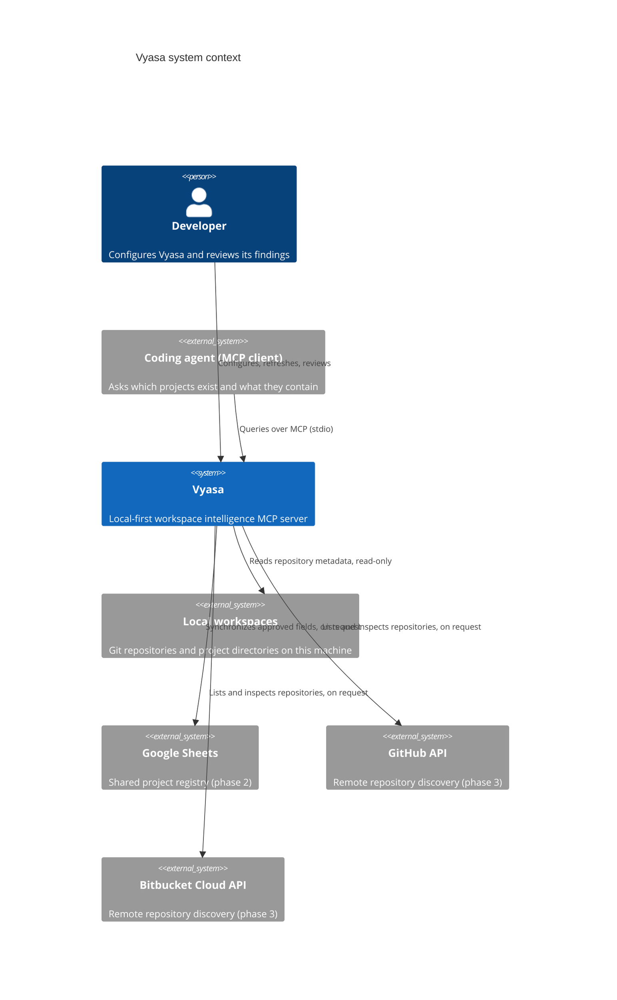
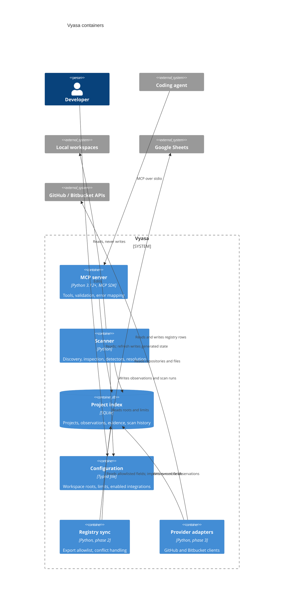
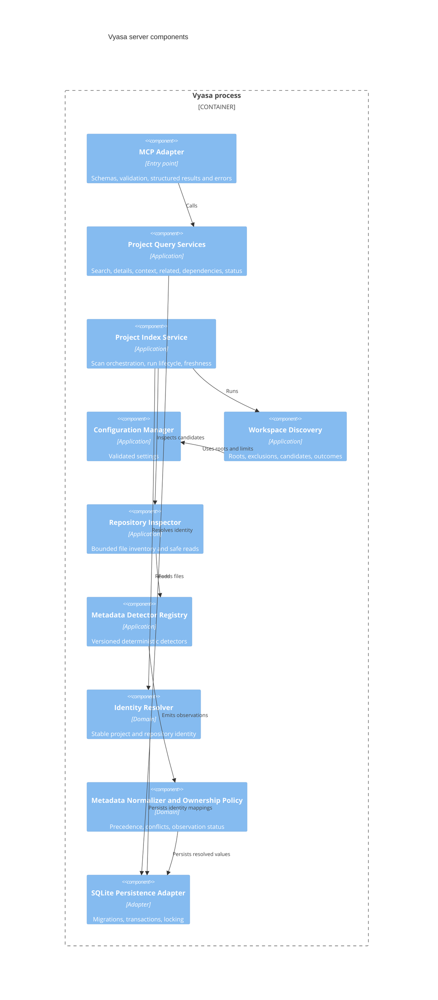

# Purpose

These views fix the names and boundaries other diagrams reuse. Each answers
one question; they are the only C4 views drawn for the whole system.[^arch]
Diagrams are Mermaid text and are unverified by a renderer in this repository.

# Context: who and what does Vyasa talk to?

# Container: what runs and what stores state?

Queries touch only the index. Scanner, sync, and providers run only on an
explicit operation and never as a side effect of a query.

# Component: how is the server organized?

Dependencies point inward: adapters depend on application services, which
depend on the domain; the domain depends on neither.

# Related

- [System Architecture](/architecture/system-architecture.md)
- [Scanning and Evidence](/architecture/scanning-and-evidence.md)
- [MCP Interface](/architecture/mcp-interface.md)

[^arch]: System Architecture
