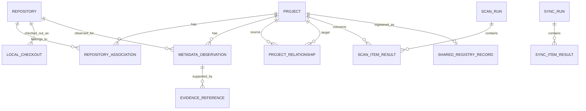

# Data Model: Principles and Entity Overview

*Sections 1–4 of [Data Model](/architecture/data-model.md).*

## 1. Purpose

This document defines the conceptual and logical data model for Vyasa.

It establishes:

- The distinction between logical projects, repositories, and local checkouts.
- Stable identity rules.
- Project metadata and its ownership.
- Metadata observations and evidence provenance.
- Scan history and freshness.
- Project relationships and dependencies.
- Local versus shared data boundaries.
- Data validation, persistence, and schema evolution requirements.

The model must support all three delivery phases without making Google Sheets, SQLite, GitHub, or Bitbucket the owner of the core domain model.

This document defines the logical model. The exact SQLite table definitions, indexes, migrations, and serialization formats will be specified in the local storage and MCP interface documents.

## 2. Design Principles

### 2.1 Separate Projects from Repositories

A logical project is the unit users want to discover and understand. A repository is a source-control unit. A local checkout is a copy of a repository on a particular device.

These concepts must not be represented as one entity.

A project may have multiple repositories. A repository may have multiple local checkouts. A project may be known to Vyasa even when no local checkout is available.

### 2.2 Separate Identity from Display Metadata

A project name, repository name, or filesystem path may change without necessarily changing the underlying identity.

Identifiers must not be generated solely from mutable display names or local paths when a more reliable identity is available.

### 2.3 Separate Values from Observations

A value such as a project name may be declared in a profile, observed in a manifest, or cached in the shared registry.

Vyasa must retain enough provenance to distinguish those sources and apply the field-specific ownership rules.

### 2.4 Preserve Unknowns and Conflicts

Missing, unknown, inaccessible, stale, and conflicting values must not be collapsed into one state.

A failed scan must not be treated as evidence that a file or project does not exist.

### 2.5 Separate Local and Shared State

Machine-specific paths and operational state belong in local storage. Only explicitly approved project metadata may be synchronized.

### 2.6 Keep the Model Provider-Neutral

The core entities must not contain mandatory Google Sheets row structures or GitHub/Bitbucket response objects.

Provider-specific identifiers may be retained as external identity references, mapped into a common representation.

---

## 3. Conceptual Entity Model

The initial domain model contains the following entities:

| Entity | Purpose |
|---|---|
| Project | Represents a logical software project. |
| Repository | Represents a Git repository identified locally or remotely. |
| Local Checkout | Represents a repository instance available on a device. |
| External Identity | Associates a project or repository with an identity from another system. |
| Metadata Observation | Records a declared or detected field value and its source. |
| Evidence Reference | Identifies the file, configuration field, or external source supporting an observation. |
| Project Relationship | Represents an explicit or deterministically derived relationship. |
| Scan Run | Records a workspace scan or refresh operation. |
| Scan Item Result | Records the outcome for an individual project, repository, or candidate. |
| Shared Registry Record | Represents shared portfolio metadata synchronized with Google Sheets. |
| Synchronization Run | Records a shared registry synchronization operation. |

The final two entities are introduced in Phase 2. Remote provider observations and discovery runs extend the model in Phase 3.

## 4. Entity Relationships

`REPOSITORY_ASSOCIATION` is a logical association between a project and a repository. It allows a project to contain multiple repositories without embedding repository details directly in the project record.

The diagram is conceptual. The implementation may use additional junction tables or foreign-key relationships as required by the persistence design.
