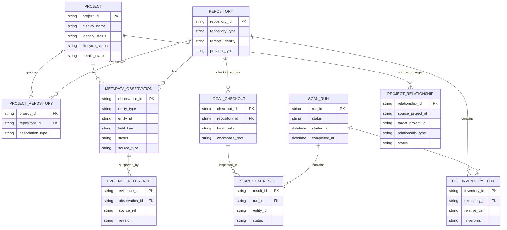

# Local Storage: Logical Storage Model

*Sections 5 of [Local Storage](/architecture/local-storage.md).*

## 5. Logical Storage Model

The database should separate stable entities from observations and operational records.

This diagram is conceptual. The physical schema may use composite keys or additional association tables where appropriate.

### 5.1 Core Storage Groups

| Group | Purpose |
|---|---|
| Identity and entities | Projects, repositories, local checkouts |
| Observations | Declared and detected metadata |
| Evidence | Source references supporting observations |
| Relationships | Dependencies and related-project links |
| Scanning | Runs, item results, detector outcomes |
| File inventory | Relevant files and fingerprints for incremental scanning |
| Resolved index | Efficiently queryable project summaries |
| Schema management | Migration version and storage compatibility |
| Future shared registry | Synchronization metadata in Phase 2 |
| Future remote discovery | Provider discovery and observation state in Phase 3 |
