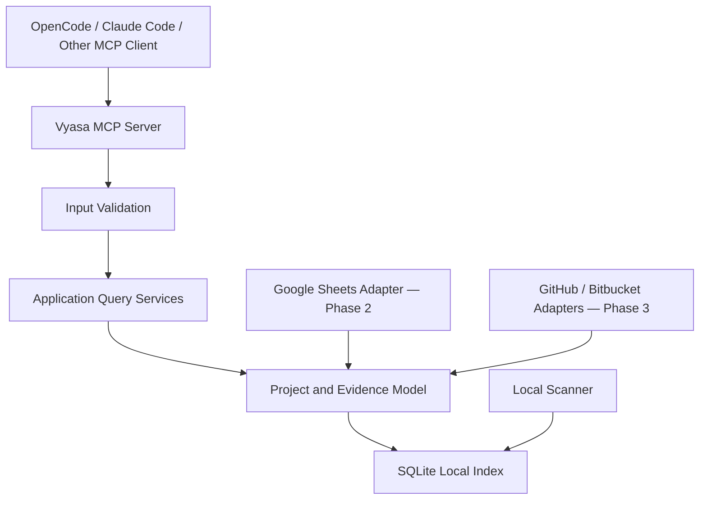

# MCP Interface: Purpose, Principles, Transport, and Tool Inventory

*Sections 1–5 of [MCP Interface](/architecture/mcp-interface.md).*

## 1. Purpose

This document defines the MCP interface through which OpenCode, Claude Code, and other MCP-compatible agents access Vyasa's workspace intelligence.

It specifies:

- MCP server responsibilities and transport.
- Public tool names and input parameters.
- Response schemas and pagination.
- Evidence, provenance, freshness, and uncertainty.
- Error handling and compatibility.
- Read-only guarantees.
- Extension rules for Google Sheets and remote repository discovery.

The interface is a contract between Vyasa and its MCP clients. Internal modules, SQLite tables, and scanning implementations may evolve without requiring unnecessary changes to this contract.

## 2. Design Principles

### 2.1 Query First

The primary purpose of the MCP interface is to answer questions about projects.

Agents should be able to:

- Find projects by name, technology, domain, or other indexed metadata.
- Retrieve a project's profile and repository information.
- Understand what a project does, where its documentation lives, and what evidence supports those details.
- Discover related projects and reusable solutions.
- Inspect declared dependencies and relationships.
- Understand index freshness and scanning coverage.

### 2.2 Read-Only Project Knowledge

MCP tools must not create, edit, or delete project-owned metadata.

The interface must not expose tools such as:

- `update_project_profile`
- `edit_project_metadata`
- `delete_project`
- `write_project_documentation`

Vyasa owns its generated index, not the contents of the projects it indexes.

An explicitly invoked index refresh may update Vyasa's own index and scan history, but it must not modify repository files or canonical profiles.

### 2.3 Evidence-Aware Responses

Project information must distinguish:

- Values explicitly declared by a project.
- Values detected from supported repository metadata.
- Values imported from a shared registry.
- Values observed from a remote provider.
- Values that remain unknown or unresolved.

When evidence is available, the response should identify the source and relevant location.

### 2.4 Stable Contracts

Tool names, parameter meanings, status values, and response structures must be documented and versioned.

Adding optional response fields should be preferred over changing existing fields incompatibly.

### 2.5 No Hidden Expensive Work

A search or detail query must not silently trigger a full workspace scan, Google Sheets synchronization, or remote API discovery.

Queries operate on the available index and communicate its freshness.

---

## 3. MCP Server Responsibilities

The MCP server is an adapter over Vyasa's application services. It is not the scanner, identity resolver, or database itself.

The diagram represents logical responsibilities, not a requirement that every adapter be active simultaneously.

The MCP server must:

1. Register supported tools and their schemas.
2. Validate arguments.
3. Invoke application services.
4. Return structured, bounded results.
5. Surface errors consistently.
6. Enforce read-only behaviour at the interface boundary.
7. Avoid leaking credentials, local secrets, or unintended filesystem details.

Business rules must remain in the application and domain layers rather than being duplicated in MCP handlers.

---

## 4. Transport and Runtime

### 4.1 Initial Transport

**Recommendation: MCP over standard input/output (stdio)** for the initial local server.

Benefits:

- Works naturally with local coding-agent tools.
- Does not require a network listener.
- Keeps the initial deployment simple.
- Avoids exposing a local service to the network unnecessarily.

The implementation should use the official Python MCP SDK and a supported FastMCP-based server implementation, subject to compatibility checks during project setup.

### 4.2 Runtime Behaviour

The server must:

- Start using validated configuration.
- Initialize the local index connection safely.
- Register only tools available in the current deployment.
- Emit protocol messages through the configured MCP transport.
- Send operational logs to stderr or an appropriate logging destination, never into the stdio protocol stream.
- Fail clearly if essential configuration or index initialization fails.
- Close resources cleanly during shutdown.

### 4.3 Phase Capabilities

| Capability | Phase 1 | Phase 2 | Phase 3 |
|---|---|---|---|
| Search indexed projects | Yes | Yes | Yes |
| Retrieve project details | Yes | Yes | Yes |
| Retrieve evidence-backed context | Yes | Yes | Yes |
| Discover related projects | Yes | Yes | Yes |
| Retrieve dependency information | Yes | Yes | Yes |
| Inspect local index status | Yes | Yes | Yes |
| Refresh local index | Yes, if enabled | Yes | Yes |
| Query shared registry-only projects | No | Yes | Yes |
| Synchronize Google Sheets | No | Yes | Yes |
| Discover remote repositories | No | No | Yes |
| Inspect remote repository metadata | No | No | Yes |

A tool that is unavailable in the current phase must not return fabricated or empty success results. The capability must either be omitted from registration or report a clearly defined unsupported-capability error.

---

## 5. Public Tool Inventory

The following names form the proposed initial MCP contract.

| Tool | Purpose | Reads index | May change Vyasa state |
|---|---|---:|---:|
| `search_projects` | Search and filter indexed projects | Yes | No |
| `get_project` | Retrieve a project's structured record | Yes | No |
| `get_project_context` | Retrieve an evidence-backed project briefing | Yes | No |
| `find_related_projects` | Discover candidate or confirmed relationships | Yes | No |
| `get_project_dependencies` | Retrieve declared dependencies and known project links | Yes | No |
| `get_index_status` | Report index freshness, coverage, and scan status | Yes | No |
| `refresh_index` | Refresh the local generated index | Yes | Yes |

The first six tools are read-only queries. `refresh_index` is a separate operational capability and may be disabled by configuration.

The server must not require the client to use `refresh_index` before every query.
