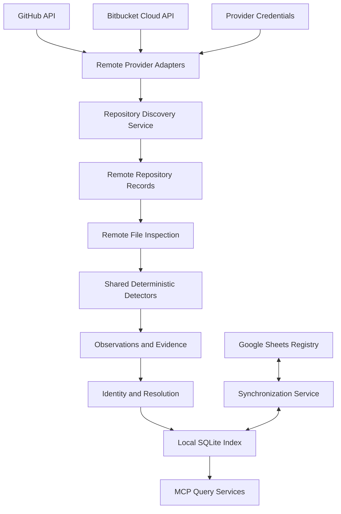

# Remote Repository Discovery: Purpose, Goals, Position, and Providers

*Sections 1–4 of [Remote Repository Discovery](/architecture/remote-repositories.md).*

## 1. Purpose

This document defines how Vyasa discovers repositories and inspects supported metadata directly from remote Git providers without cloning or checking out repositories.

The initial providers are:

- GitHub.
- Bitbucket Cloud.

The remote discovery layer extends Vyasa's local-first architecture. It enables the system to discover projects that are not present in the current device's workspaces and to inspect authorized repositories without creating local copies.

This document defines:

- Provider adapter responsibilities.
- Repository discovery and identity.
- Authentication and permissions.
- Remote file inspection.
- Pagination, rate limits, caching, and retries.
- Evidence and revision tracking.
- Reconciliation with local observations and Google Sheets.
- Remote-only projects and repositories.
- MCP integration.
- Security and acceptance criteria.

The design must preserve the existing principle that repository-owned knowledge remains owned by its repository, while Vyasa provides deterministic discovery, indexing, and read-only access.

## 2. Goals and Non-Goals

### 2.1 Goals

Vyasa must be able to:

1. Discover repositories available to a configured GitHub or Bitbucket Cloud connection.
2. Enumerate repositories across supported user and organization or workspace scopes.
3. Identify public and authorized private repositories.
4. Retrieve supported repository metadata through provider APIs.
5. Inspect selected files without cloning the repository.
6. Extract supported metadata using the existing deterministic detector framework.
7. Associate remote repositories with existing logical projects where identity is unambiguous.
8. Make remote-only projects discoverable through the shared project index.
9. Preserve source provenance, revision, freshness, and access status.
10. Handle pagination, rate limiting, partial failures, and provider outages safely.
11. Keep credentials outside project metadata, Google Sheets, and ordinary tool responses.
12. Support incremental remote discovery without repeatedly downloading unchanged content.

### 2.2 Non-Goals

The initial implementation does not:

- Clone or checkout remote repositories.
- Push commits or modify remote files.
- Create pull requests or branches.
- Run repository code, build scripts, or tests.
- Execute Git commands that fetch or modify remote state.
- Replace GitHub or Bitbucket as the repository authority.
- Guarantee visibility into repositories that the configured credentials cannot access.
- Automatically delete or archive repositories.
- Infer project quality or purpose using an LLM.
- Treat remote metadata as proof that a local checkout exists.
- Automatically merge forks, mirrors, or similarly named repositories.

---

## 3. Architectural Position

Remote discovery is an additional provider adapter. It must reuse the existing identity, observation, evidence, and query services rather than introducing a separate project knowledge model.

The diagram represents logical responsibilities. Google Sheets synchronization and remote discovery remain independently configurable.

### 3.1 Separation of Responsibilities

| Component | Responsibility |
|---|---|
| Provider adapter | Authenticate, call APIs, normalize provider responses |
| Discovery service | Enumerate repositories and track discovery completeness |
| Remote inspector | Retrieve selected file metadata and content |
| Detector framework | Extract deterministic observations from supported inputs |
| Identity resolver | Match remote repositories to logical projects |
| Evidence service | Record provider, path, revision, and observation time |
| SQLite storage | Persist local index and remote discovery state |
| Synchronization service | Publish approved shared summaries to Google Sheets |
| MCP interface | Expose evidence-backed remote project information |

Provider-specific API logic must not leak into the domain model.

---

## 4. Provider Support

### 4.1 GitHub

The initial GitHub adapter should support:

- Public repository discovery.
- Authenticated repository discovery for the configured account and authorized organizations.
- Repository metadata retrieval.
- Default branch and current commit metadata, when available.
- Selected file metadata and content retrieval.
- Pagination and rate-limit handling.
- Provider-specific repository identity.
- Safe access-status reporting.

The exact API endpoints and permissions must be verified against the selected GitHub API version during implementation.

### 4.2 Bitbucket Cloud

The initial Bitbucket Cloud adapter should support:

- Repository discovery within explicitly configured workspaces.
- Access to public repositories and authorized private repositories.
- Repository metadata retrieval.
- Default branch and commit information, when available.
- Selected file metadata and content retrieval.
- Pagination and API error handling.
- Provider-specific repository identity.

The adapter must target **Bitbucket Cloud**, not assume that Bitbucket Data Center or Server has the same API or authentication model.

### 4.3 Provider Capability Matrix

The implementation should maintain a capability matrix.

| Capability | GitHub | Bitbucket Cloud |
|---|---|---|
| Public repository discovery | Supported where accessible | Supported where accessible |
| Authorized private repositories | Supported | Supported |
| Organization/workspace scope | Supported through configured access | Supported through configured workspace access |
| Repository metadata | Supported | Supported |
| Selected file inspection | Supported | Supported |
| Pagination | Required | Required |
| Revision-aware observations | Required where available | Required where available |
| Clone or checkout | Not used | Not used |
| Repository modification | Not used | Not used |

Any capability unavailable for a particular provider, repository, or permission set must be reported explicitly.
