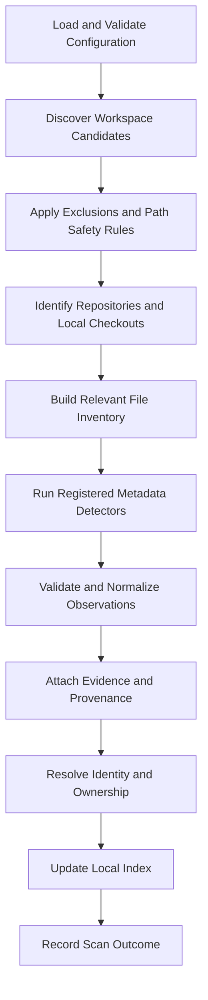

# Scanning and Evidence: Principles and Scanning Pipeline

*Sections 1–3 of [Scanning and Evidence](/architecture/scanning-and-evidence.md).*

## 1. Purpose

This document defines how Vyasa discovers project information, extracts metadata, records evidence, evaluates freshness, and decides when existing observations must be updated.

It establishes:

- Workspace traversal and repository discovery rules.
- Supported metadata detector categories.
- Evidence requirements for detected and declared facts.
- Rules for representing missing, unknown, inaccessible, stale, and conflicting information.
- Incremental scanning and cache invalidation.
- Safe handling of untrusted repository content.
- Local and remote evidence distinctions.
- Testing requirements for deterministic extraction.

This document defines scanner behaviour, not the physical SQLite schema or MCP tool contracts.

## 2. Core Scanning Principles

### 2.1 Deterministic Extraction

Vyasa MUST use documented rules and recognized evidence sources to extract metadata.

Routine scanning MUST NOT require an LLM to interpret a repository, infer its purpose, classify its quality, or invent missing fields.

Given the same relevant inputs, detector configuration, and detector version, the scanner must produce equivalent observations.

### 2.2 Evidence Before Claims

Every detected or declared fact MUST have an identifiable source wherever practical.

The scanner must not promote a plausible assumption into a confirmed fact.

Examples:

- A `pyproject.toml` file establishes the presence of a recognized Python project manifest, but not that every declared dependency is installed.
- A README containing the word "React" does not by itself prove that React is a project dependency.
- A directory named `tests` is evidence of a test-related directory, not proof that the tests execute successfully.
- An OpenSpec directory does not establish that OpenSpec is correctly configured or that meaningful specifications exist.

### 2.3 Missing Is Not False

Vyasa must distinguish between an indicator that was not found, a source that could not be read, and a source format that is unsupported.

The absence of evidence must not be presented as proof of absence when the scan was incomplete.

### 2.4 Read-Only Scanning

Ordinary scanning MUST NOT modify repository files, canonical project profiles, Git history, or remote repositories.

The scanner may update its own index, evidence inventory, and operational state.

Optional draft generation is a separate, explicitly enabled operation with its own lifecycle rules.

### 2.5 Explicit Detector Coverage

Vyasa must document what each detector supports and what it does not support.

A detector must not claim comprehensive coverage of a technology, framework, test suite, or documentation standard when it recognizes only a subset of the relevant files.

### 2.6 Source Ownership

Scanning records observations; it does not override the field ownership model.

A detector may observe a project name, for example, but the final resolved value must follow the field-specific ownership and precedence rules of that field, applied during metadata resolution (§12).

---

## 3. Scanning Architecture

The scanning pipeline consists of distinct stages.

Each stage has a defined responsibility.

| Stage | Responsibility |
|---|---|
| Configuration | Validate roots, exclusions, and scan options. |
| Discovery | Identify eligible project and repository candidates. |
| Path safety | Enforce boundaries and traversal rules. |
| Repository inspection | Identify Git metadata and supported repository files. |
| File inventory | Identify files relevant to enabled detectors. |
| Detection | Extract facts using registered rules. |
| Validation | Validate values against field definitions. |
| Evidence | Attach source references and observation details. |
| Identity and ownership | Resolve identities and apply field-specific policies. |
| Index update | Persist generated observations safely. |
| Reporting | Record successful, partial, failed, and interrupted outcomes. |

A failure in one detector should not prevent unrelated detectors from running unless a shared prerequisite has failed.
