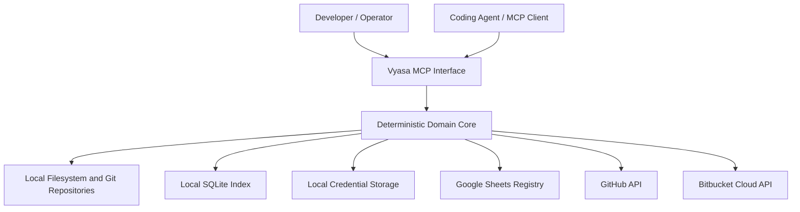

# Vyasa (व्यास): Objectives, Scope, and Threat Model

*Sections 1–3 of [Vyasa (व्यास)](/architecture/security-and-privacy.md).*

## 1. Purpose

This document describes the security and privacy model of Vyasa: a local-first workspace intelligence system that discovers software projects, extracts deterministic metadata, indexes evidence, and exposes project knowledge to coding agents through MCP.

Vyasa may inspect repositories containing proprietary source code, internal architecture documents, local filesystem paths, dependency information, Git history metadata, and references to credentials or other sensitive information. Phase 2 introduces a shared Google Sheets registry, while Phase 3 introduces authenticated access to GitHub and Bitbucket Cloud APIs.

Security and privacy are therefore architectural properties from the beginning, not features added after implementation.

### 1.1 Security objectives

1. Protect source repositories from unintended modification.
2. Keep source code and detailed local metadata on the user's machine by default.
3. Prevent credentials, secrets, and sensitive local information from entering shared registries or logs.
4. Restrict filesystem, network, and provider access to explicitly configured boundaries.
5. Treat repository content and remote API responses as untrusted data.
6. Ensure coding agents receive only the information requested and permitted by the MCP interface.
7. Preserve integrity during indexing, synchronization, recovery, and partial failure.
8. Make security-sensitive operations explicit and observable.

### 1.2 Guiding principle

**Vyasa discovers and shares approved project knowledge; it does not become an unrestricted reader, writer, or distributor of everything in a workspace.**

---

## 2. Scope and security posture

### 2.1 In scope

- Workspace and repository discovery.
- Filesystem traversal and file inspection.
- Git metadata and remote URL inspection.
- Deterministic metadata extraction and evidence storage.
- Local SQLite storage, logs, temporary files, and backups.
- MCP server startup, tool execution, input validation, and responses.
- Optional project-profile draft generation.
- Google Sheets authentication, export, import, and synchronization.
- GitHub and Bitbucket Cloud authentication and API access.
- Dependency and relationship discovery.
- Error handling, recovery, data retention, and deletion.
- Security testing and operational guidance.

### 2.2 Out of scope

Unless introduced by a separately approved requirement, Vyasa will not:

- Execute repository scripts, build commands, hooks, or arbitrary project code during scanning.
- Install or run project dependencies to discover metadata.
- Upload source files or repository contents wholesale.
- Send repository content to an LLM or other external analysis service.
- Automatically modify canonical project documentation.
- Automatically delete, archive, or modify repositories.
- Act as a general-purpose filesystem MCP server.
- Provide a remote public-facing MCP endpoint.
- Claim regulatory compliance solely because these controls are implemented.

### 2.3 Default posture

| Area | Default |
|---|---|
| Repository access | Read-only |
| Filesystem scope | Explicitly configured roots |
| Network access | Disabled for Phase 1 query and scan operations unless needed by a separately enabled capability |
| Local index | Machine-local SQLite |
| Source code retention | Not copied into the index |
| Shared registry | Explicit synchronization only |
| Remote discovery | Explicitly configured and invoked |
| Credentials | Local secure storage; never in the shared registry |
| Missing metadata | Reported as unknown or not detected |
| Security failure | Fail closed for sensitive actions; preserve usable local functionality where safe |

---

## 3. Threat model

Vyasa is primarily a local developer tool, but it operates across multiple trust boundaries. A local process should not be assumed harmless simply because it runs on the developer's machine.

### 3.1 Assets to protect

| Asset | Security concern |
|---|---|
| Source repositories | Unauthorized reading, modification, or accidental execution |
| Project documentation | Disclosure of proprietary architecture or internal plans |
| Local paths and workspace layout | Disclosure of usernames, machine structure, and internal organization |
| SQLite index | Unauthorized access, tampering, or stale/conflicting information |
| Evidence records | Leakage of file contents, sensitive paths, or internal implementation details |
| Google credentials | Unauthorized access to the shared registry or other Google resources |
| GitHub and Bitbucket tokens | Unauthorized repository or account access |
| Shared registry | Disclosure or corruption of cross-project metadata |
| MCP responses | Excessive disclosure to a connected coding agent |
| Logs and backups | Persistent copies of sensitive information |
| Project identity and relationships | Incorrectly grouping unrelated repositories or exposing private associations |

### 3.2 Threat actors and failure sources

The design must consider:

- Accidental misuse by a developer or coding agent.
- A malicious or compromised repository containing crafted files, symlinks, or misleading metadata.
- A compromised or over-permissioned MCP client.
- A malicious remote repository or unexpected API response.
- Leaked, expired, or over-scoped provider credentials.
- Incorrect Google Sheets permissions or accidental sharing.
- Bugs in path handling, identity resolution, serialization, or synchronization.
- Local malware or another process running with the same operating-system privileges.
- A machine backup, log archive, or shared folder exposing information unexpectedly.

### 3.3 Trust boundaries

The diagram represents logical boundaries, not permission to access every connected resource. Each connection must be gated by the relevant phase, configuration, capability, and access policy.

### 3.4 Threat-model limitation

Vyasa cannot protect a user's repositories or credentials from an attacker who already has unrestricted control of the user's operating-system account. It should nevertheless avoid creating unnecessary access paths, leaking information into logs or shared services, or making such compromise easier.
