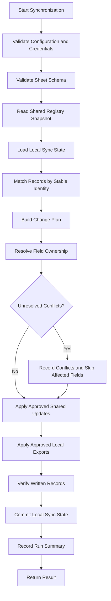

# Synchronization: Synchronization Modes and Workflow

*Sections 7–8 of [Synchronization](/architecture/synchronization.md).*

## 7. Synchronization Modes

The application should distinguish initial synchronization from normal incremental synchronization.

### 7.1 Initial Pull

Initial pull imports eligible shared records into the local cache.

It should:

- Validate the spreadsheet schema.
- Read the relevant registry tabs.
- Validate stable IDs and required fields.
- Identify duplicate IDs or malformed rows.
- Import approved shared-owned fields.
- Record source provenance and the last successful pull.
- Preserve existing local-only information.
- Report conflicts rather than overwriting them.

Initial pull must not claim that remote or local repository files have been scanned.

### 7.2 Initial Push

Initial push publishes eligible local projects that are not yet represented in the shared registry.

Before pushing:

- Confirm project identity.
- Validate exportable fields.
- Check for existing records.
- Detect possible duplicates.
- Preserve shared human-managed values.
- Exclude machine-local fields and secrets.

If an existing shared record is found by stable ID, perform an approved upsert rather than inserting a duplicate.

### 7.3 Bidirectional Synchronization

Normal synchronization consists of two logical directions:

1. **Pull:** retrieve approved shared-owned changes.
2. **Push:** publish approved locally generated changes.

The implementation may read and plan both directions before writing either direction.

It must define the order explicitly and preserve conflict information throughout the operation.

### 7.4 Full Reconciliation

A full reconciliation compares the local and shared views and reports:

- Records present in both places.
- Local-only projects.
- Shared-only projects.
- Records with changed scanner-owned fields.
- Records with changed shared-owned fields.
- Identity conflicts.
- Duplicate candidates.
- Incomplete or inaccessible records.

A full reconciliation is not permission to delete unmatched records.

### 7.5 Read-Only Sync

A diagnostic or dry-run mode should calculate the planned changes without applying them.

It should report the proposed creates, updates, conflicts, and skipped records.

The dry-run must not mutate the shared registry or change canonical project metadata.

---

## 8. Synchronization Workflow

The diagram illustrates the logical workflow. The exact order of remote writes and local state commits must account for the fact that SQLite and Google Sheets cannot participate in one atomic distributed transaction.

### 8.1 Plan Before Write

The synchronizer should build a change plan before applying updates.

The plan identifies:

- Records to insert.
- Fields to update.
- Fields to preserve.
- Conflicts.
- Records that need human review.
- Rows that could not be validated.

This reduces unintended overwrites and makes dry-run behaviour straightforward.

### 8.2 Field-Level Changes

Where practical, updates should be applied at field level rather than replacing an entire row.

A scanner update to technologies must not clear a human-managed tracking level or overwrite a portfolio classification.

### 8.3 Local Commit

The local synchronization state should be committed only after the corresponding remote operation is known to have succeeded, or marked as pending verification when the result is ambiguous.

A timeout does not prove that Google Sheets rejected a write.

### 8.4 Partial Success

The system must record partial success when some records are synchronized and others fail.

A partial run must not be reported as fully successful.
