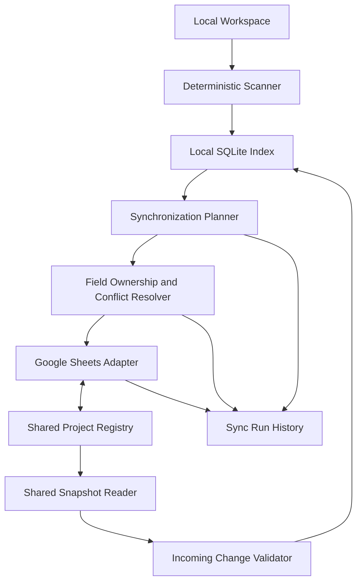

# Synchronization: Principles and Architecture

*Sections 1–3 of [Synchronization](/architecture/synchronization.md).*

## 1. Purpose

This document defines how Vyasa synchronizes project metadata between a local SQLite index and a shared Google Sheets registry.

The synchronization system must allow multiple devices to maintain independent local workspace indexes while sharing a consistent portfolio-level view of projects.

It defines:

- The role of Google Sheets in the overall architecture.
- The shared registry structure.
- Field ownership and synchronization direction.
- Stable identity and record matching.
- Upserts, conflict detection, and deletion handling.
- Initial synchronization and incremental synchronization.
- Failure recovery, retries, and idempotency.
- Authentication, privacy, and export controls.
- Local and shared project discovery.
- Synchronization status, history, and testing.

This document covers Phase 2 only. GitHub and Bitbucket Cloud discovery remain Phase 3 capabilities.

## 2. Core Design Principles

### 2.1 Google Sheets Is the Shared Registry

Google Sheets is a shared, cross-device registry of logical projects and approved project metadata.

It is not simply an export destination or reporting dashboard.

A device that has not cloned a project must still be able to discover that project through the shared registry, subject to the available metadata.

### 2.2 SQLite Is the Local Index

Each device maintains its own SQLite database.

SQLite contains local scan observations, evidence references, checkout mappings, and query-ready project data. It may also cache approved shared-registry values.

A synchronization failure must not prevent queries against the last usable local index.

### 2.3 Ownership Is Field-Specific

There is no universal rule that local SQLite or Google Sheets always wins.

Each field has a defined owner:

- Repository-owned fields originate from the project repository.
- Scanner-generated fields originate from supported observations.
- Shared human-managed fields originate from the portfolio registry.
- Machine-local fields remain on the device.
- Derived fields are computed according to documented rules.

Synchronization must respect these ownership boundaries.

### 2.4 Idempotency

Repeating the same synchronization operation must not create duplicate projects or repeatedly overwrite unchanged values.

The system must safely retry operations after timeouts or partial failures.

### 2.5 No Silent Data Loss

Synchronization must not silently discard human edits, erase valid local observations, or delete shared records because a device no longer sees a repository.

Conflicts must be surfaced and handled according to explicit rules.

### 2.6 Privacy by Default

Only explicitly approved fields may leave the local device.

Local paths, workspace roots, database paths, credentials, and machine-specific scan state must never be exported through a generic object serializer.

---

## 3. Architecture

The synchronization service coordinates the process, but the scanner and repository-owned profile remain separate components.

The Google Sheets adapter handles spreadsheet access. It must not independently decide project identity, field ownership, or conflict resolution.

### 3.1 Responsibilities

| Component | Responsibility |
|---|---|
| Local scanner | Observe repository state using deterministic rules |
| SQLite index | Store local observations, evidence, and cached shared data |
| Synchronization planner | Determine eligible outbound and inbound changes |
| Ownership resolver | Decide which source may update each field |
| Sheets adapter | Read and write approved spreadsheet records |
| Conflict handler | Record unresolved disagreements |
| Sync history | Record attempted, completed, and failed synchronization work |

### 3.2 Separation From MCP Queries

Ordinary MCP queries must not implicitly synchronize with Google Sheets.

Synchronization should be an explicit application operation, whether initiated through a CLI, a separately enabled MCP tool, or another approved interface.

A later MCP tool may be named `sync_shared_registry`. Its inputs, write effects, and capability requirements must be documented before implementation.
