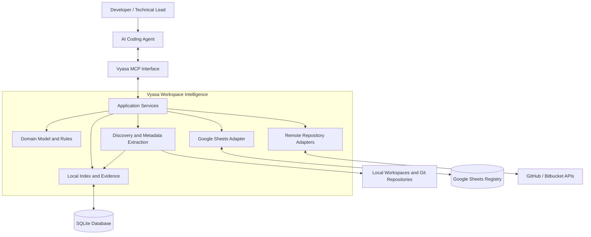

# System Architecture: Context and Vision

*Sections 1–3 of [System Architecture](/architecture/system-architecture.md).*

## 1. Purpose

This document defines the logical architecture of Vyasa, including its components, responsibilities, dependencies, data flows, and extension points.

Vyasa is a workspace intelligence system that discovers projects, extracts verifiable metadata, maintains a searchable project index, and exposes project information to AI coding agents.

It will evolve through three phases:

1. Local workspace scanning, SQLite indexing, and MCP access.
2. Shared project registry through Google Sheets.
3. Remote repository discovery through GitHub and Bitbucket APIs.

The architecture must support these phases through a common domain model without making external integrations mandatory for local operation.

## 2. Architectural Vision

Vyasa provides a common intelligence layer across independent software projects while leaving each project in control of its own source code and documentation.

The architecture follows these principles:

- **Local-first:** Core functionality works without external services.
- **Deterministic:** Supported facts are extracted through explicit rules, not LLM inference.
- **Evidence-backed:** Extracted facts retain their provenance and freshness information.
- **Read-only by default:** Repository scanning does not modify maintained project content.
- **Project-owned knowledge:** Canonical project metadata remains under the project's control.
- **Shared domain model:** All adapters translate to and from common domain concepts.
- **Explicit data ownership:** Synchronization does not silently transfer ownership.
- **Incremental evolution:** Each phase delivers useful functionality independently.
- **Testable boundaries:** Core rules can be tested without databases, MCP transport, or external APIs.

## 3. System Context

Vyasa operates between the project portfolio and the developer's AI coding tools.

The diagram represents logical responsibilities, not a requirement that every component run as a separate process.

For Phase 1, the MCP server, application services, scanner, and SQLite adapter may all run within one Python process.

### 3.1 External Systems

| System | Responsibility |
|---|---|
| Local workspaces | Source of local repository files and project evidence |
| Git metadata | Source of local repository identity and configured remotes |
| SQLite | Persistent local index and operational state |
| MCP clients | Consumers of project discovery and context tools |
| Google Sheets | Shared registry introduced in Phase 2 |
| GitHub API | Remote repository discovery introduced in Phase 3 |
| Bitbucket Cloud API | Remote repository discovery introduced in Phase 3 |
