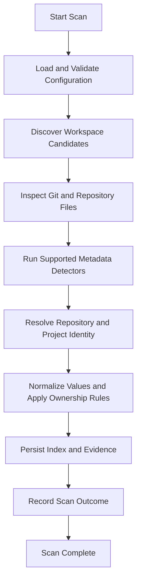
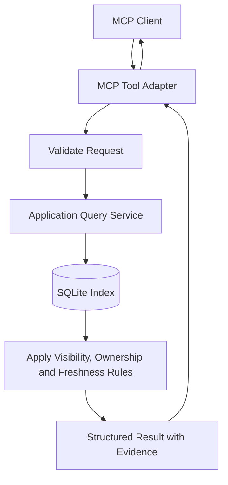

# System Architecture: Scan, Query, MCP, and Storage Data Flows

*Sections 9–12 of [System Architecture](/architecture/system-architecture.md).*

## 9. Phase 1 Data Flow

The local indexing flow should be independent of Google Sheets and remote provider access.

### 9.1 Scan Behaviour

1. Validate configuration before traversal.
2. Discover eligible project and repository candidates.
3. Apply exclusions and path-safety rules.
4. Inspect recognized files and Git metadata.
5. Run supported deterministic detectors.
6. Resolve stable identities.
7. normalize observations and apply ownership policies.
8. Commit index updates safely.
9. Record scan outcome, errors, and freshness.
10. Return a structured summary.

A failure affecting one repository should not unnecessarily terminate the entire scan.

The implementation must define transaction boundaries so that interrupted operations do not report incomplete updates as a successful complete scan.

### 9.2 Incremental Scanning

Incremental scanning may reuse prior observations when the system can establish that their inputs and detector versions remain valid.

Invalidation must account for:

- Relevant file changes.
- Deleted files.
- Changes in detector configuration.
- Detector version changes.
- Canonical profile changes.
- Git remote changes.
- Repository identity changes.

An incremental scan must not reuse stale facts merely because a file timestamp appears unchanged when other invalidation evidence indicates that the result is no longer trustworthy.

## 10. Query Data Flow

Project retrieval must not depend on a fresh scan for every request.

The query layer should:

- Validate inputs.
- Resolve the requested project identity.
- Retrieve indexed observations.
- Apply the documented ownership and freshness rules.
- Return structured data and evidence.
- Distinguish empty results from failures.

If shared registry records are added in Phase 2, query services must distinguish shared project knowledge from locally accessible repository content.

## 11. MCP Interface Architecture

The MCP adapter exposes application capabilities without becoming a second business-logic layer.

### 11.1 Initial Read Tools

| Tool | Responsibility |
|---|---|
| `search_projects` | Search projects using supported metadata and filters |
| `get_project` | Retrieve a project's indexed details |
| `get_project_context` | Return structured context for an agent working on a project |
| `find_related_projects` | Find projects related by documented deterministic criteria |
| `get_project_dependencies` | Retrieve supported dependency information |
| `get_index_status` | Report scan state, freshness, and index health |

An optional refresh tool may trigger an authorized scan and update generated index state.

### 11.2 Response Design

Responses should provide:

- Stable project or repository identifiers.
- Structured field values.
- Source provenance where practical.
- Freshness and availability status.
- Explicit unknown or unsupported states.
- Predictable error information.

The MCP adapter must not convert missing facts into invented narrative summaries.

### 11.3 Transport

The initial transport should be a local transport, with stdio the leading candidate.

The transport decision must be finalized before implementation. Network exposure, if introduced later, requires an explicit authentication and access-control design.

## 12. SQLite Storage Architecture

SQLite stores local project intelligence and operational state.

Logical storage areas include:

- Projects.
- Repositories.
- Local checkouts.
- Metadata observations.
- Evidence references.
- Project relationships.
- Scan runs and outcomes.
- Detector or schema versions.
- Synchronization state, introduced in Phase 2.
- Remote discovery state, introduced in Phase 3.

The exact tables, indexes, constraints, and migrations belong in [local-storage](/architecture/local-storage.md).

### 12.1 Storage Principles

- Keep local-only data in local storage.
- Use transactions for related index updates.
- Enforce identity constraints where possible.
- Support controlled schema migrations.
- Index fields used frequently in searches.
- Avoid storing entire documentation files when source references suffice.
- Make the index rebuildable from available evidence.
- Define retention rules for historical observations and errors.
