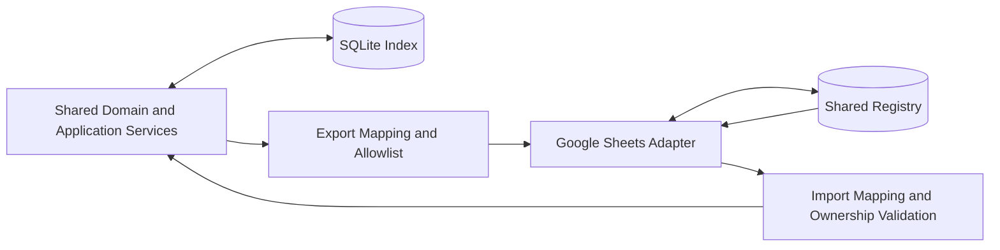
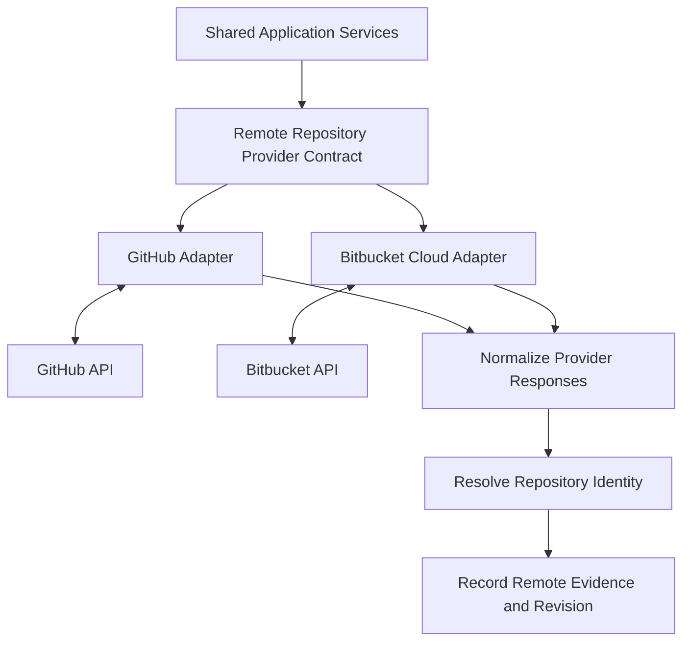

# System Architecture: Phase 2 and 3 Integrations and Security Architecture

*Sections 13–15 of [System Architecture](/architecture/system-architecture.md).*

## 13. Phase 2 — Google Sheets Integration

Phase 2 introduces shared metadata without replacing SQLite.

### 13.1 Responsibilities

- Map shared fields to registry columns.
- Validate the registry schema before writes.
- Export only approved fields.
- Import only fields designated as shared or portfolio-owned.
- Preserve local paths and machine-specific state.
- Preserve human-managed registry values.
- Detect conflicts.
- Record synchronization outcomes.

### 13.2 Cross-Device Behaviour

A project can exist in the shared registry without a local checkout.

The query layer must distinguish:

- Project known in the shared registry.
- Repository known through a remote URL.
- Repository accessible as a local checkout.
- Repository currently inaccessible or not present locally.

The absence of a local checkout must not be interpreted as the absence of the project.

### 13.3 Failure Isolation

If Google Sheets is unavailable, local queries and indexing must continue to work.

Synchronization failure must not invalidate successful local scans or overwrite locally stored data with incomplete responses.

The synchronization adapter must follow the field ownership and conflict policy of the field being synchronized; see [synchronization](/architecture/synchronization.md).

## 14. Phase 3 — Remote Repository Discovery

Phase 3 introduces provider adapters for GitHub and Bitbucket Cloud.

### 14.1 Provider Contract

The common provider contract should support:

- Enumerating accessible repositories.
- Retrieving repository metadata.
- Reading supported files or file metadata.
- Reporting provider identity and access status.
- Handling pagination.
- Reporting rate-limit and authorization errors.

The contract must not require every provider to expose identical metadata. Unsupported fields remain unknown.

### 14.2 No-Clone Rule

Remote discovery and supported file inspection must not require a clone or checkout.

Remote providers may retrieve supported files through their APIs and return the necessary evidence to the scanner or detector services.

### 14.3 Provider Isolation

GitHub and Bitbucket failures must be isolated from each other and from local indexing.

A failed remote request must not cause a project to be marked deleted or absent.

## 15. Security Architecture

Security is a cross-cutting responsibility.

### 15.1 Filesystem Boundary

- Scan only configured roots and permitted paths.
- Apply exclusions consistently.
- Define symlink handling.
- Prevent unintended traversal outside permitted roots.
- Treat repository files as untrusted input.
- Do not execute repository scripts to extract metadata.

### 15.2 Local State

- Store machine-specific paths only locally.
- Keep credentials out of the project index where possible.
- Use protected credential storage for external integrations.
- Sanitize diagnostic output.

### 15.3 Shared Registry

- Apply an explicit field export allowlist.
- Exclude secrets and local filesystem details.
- Validate imported values.
- Respect human field ownership.
- Avoid unrestricted export of local records.

### 15.4 MCP Boundary

- Keep tool capabilities narrowly scoped.
- Make read-only behaviour the default.
- Separate optional index refresh from project-content modification.
- Require explicit configuration for any network-exposed transport.
