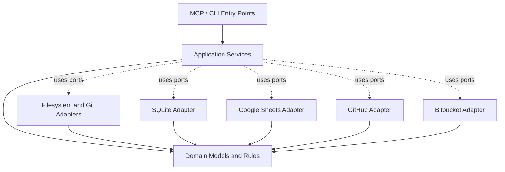

# System Architecture: Dependency Direction and Package Structure

*Sections 6–7 of [System Architecture](/architecture/system-architecture.md).*

## 6. Dependency Direction

Dependencies must point toward stable domain concepts rather than external infrastructure.



The arrows to infrastructure adapters represent application services using defined ports; they do not require the domain layer to import those adapters.

The intended dependency rules are:

1. Domain modules do not import infrastructure modules.
2. Application services depend on domain concepts and abstract ports.
3. Adapters implement the ports defined for the application.
4. Entry points call application services.
5. External integrations remain optional unless explicitly enabled.
6. Provider-specific logic is confined to its adapter and mapping code.

## 7. Proposed Package Structure

The following is a proposed Python package layout. Exact module names can be refined during implementation without changing the architectural boundaries.

```text
vyasa/
├── pyproject.toml
├── README.md
├── docs/
├── tests/
└── src/
    └── vyasa/
        ├── domain/
        │   ├── models/
        │   ├── identity/
        │   ├── metadata/
        │   ├── evidence/
        │   ├── ownership/
        │   └── relationships/
        ├── application/
        │   ├── ports/
        │   ├── discovery/
        │   ├── scanning/
        │   ├── indexing/
        │   ├── projects/
        │   ├── search/
        │   ├── synchronization/
        │   └── remote_discovery/
        ├── adapters/
        │   ├── filesystem/
        │   ├── git/
        │   ├── detectors/
        │   ├── persistence/
        │   │   └── sqlite/
        │   ├── mcp/
        │   ├── google_sheets/
        │   └── repositories/
        │       ├── github/
        │       └── bitbucket/
        ├── configuration/
        ├── observability/
        └── bootstrap/
```

This structure is illustrative, not a requirement to create empty packages for every future capability in Phase 1.

Only implement modules needed for the active phase. Reserve extension points where they provide real architectural value, without prematurely implementing future integrations.
