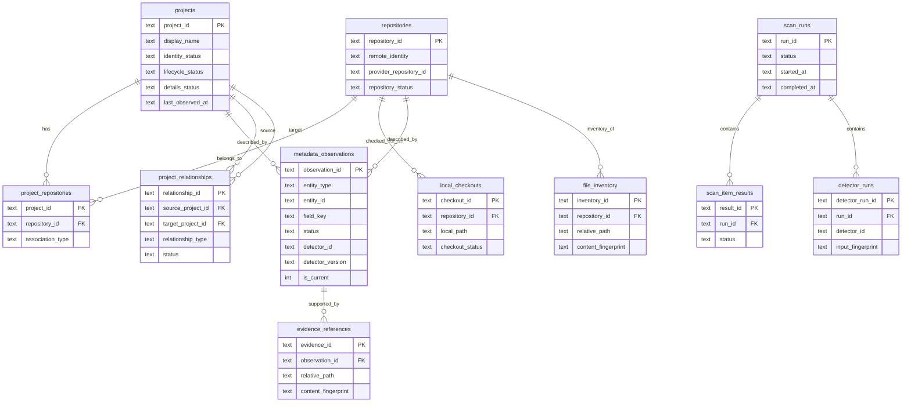
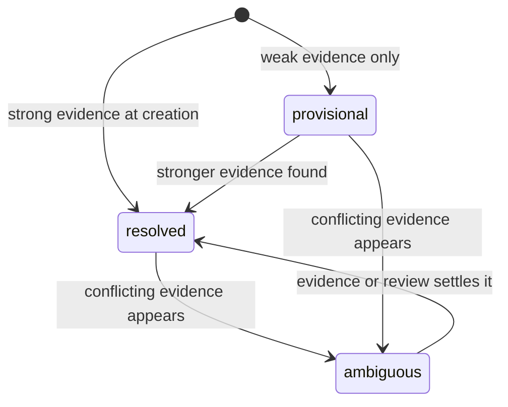
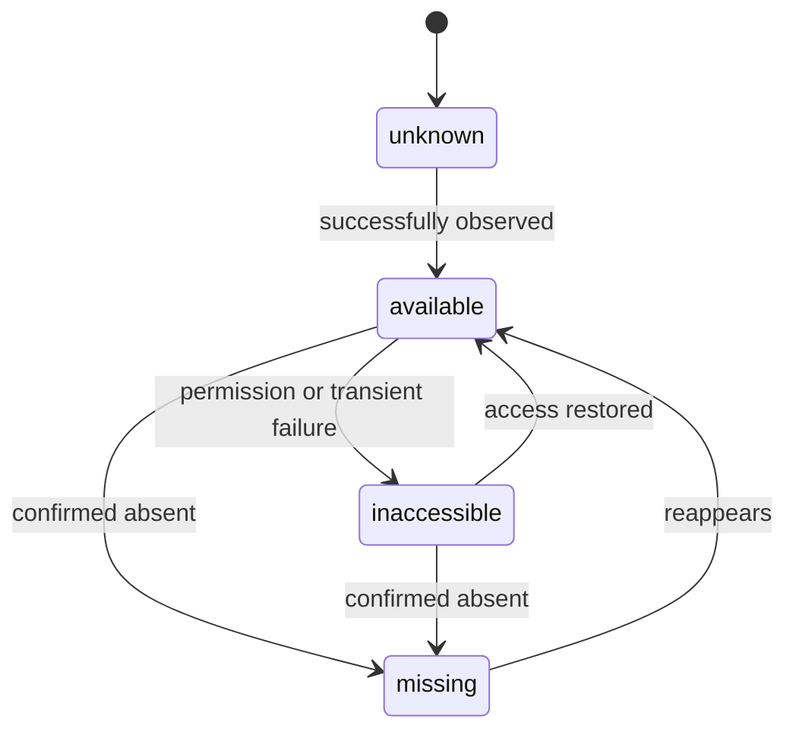
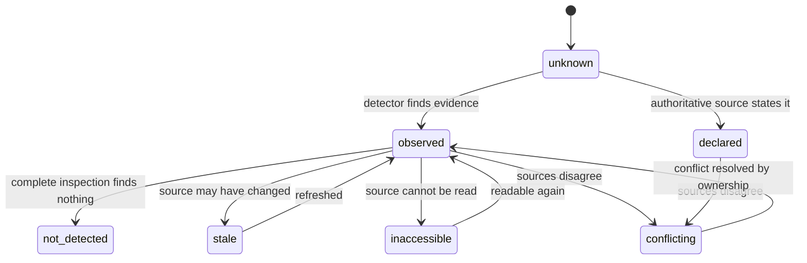
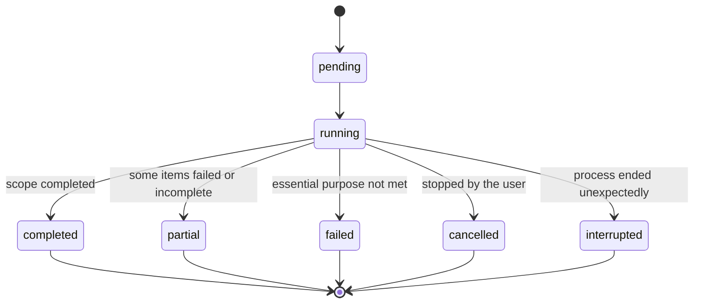

# Question

Which tables hold what, how do they connect, and which states can the key entities be in?

# Tables and their keys

The diagram shows the key columns only; the full field lists are in the table concepts. `local_path` is machine-local and is
never exported. The resolved index is a projection built from observations and is not drawn.

# Identity status

# Availability of repositories and checkouts

A timeout or permission failure never sets `missing`, and `missing` never deletes the project or repository record.

# Value status of an observation

# Run status

An interrupted or cancelled run is never reported as a successful complete run.

# Related

- [Data Model](/architecture/data-model.md)
- [Local Storage](/architecture/local-storage.md)
- [Evidence and Provenance](/concepts/evidence-and-provenance.md)
