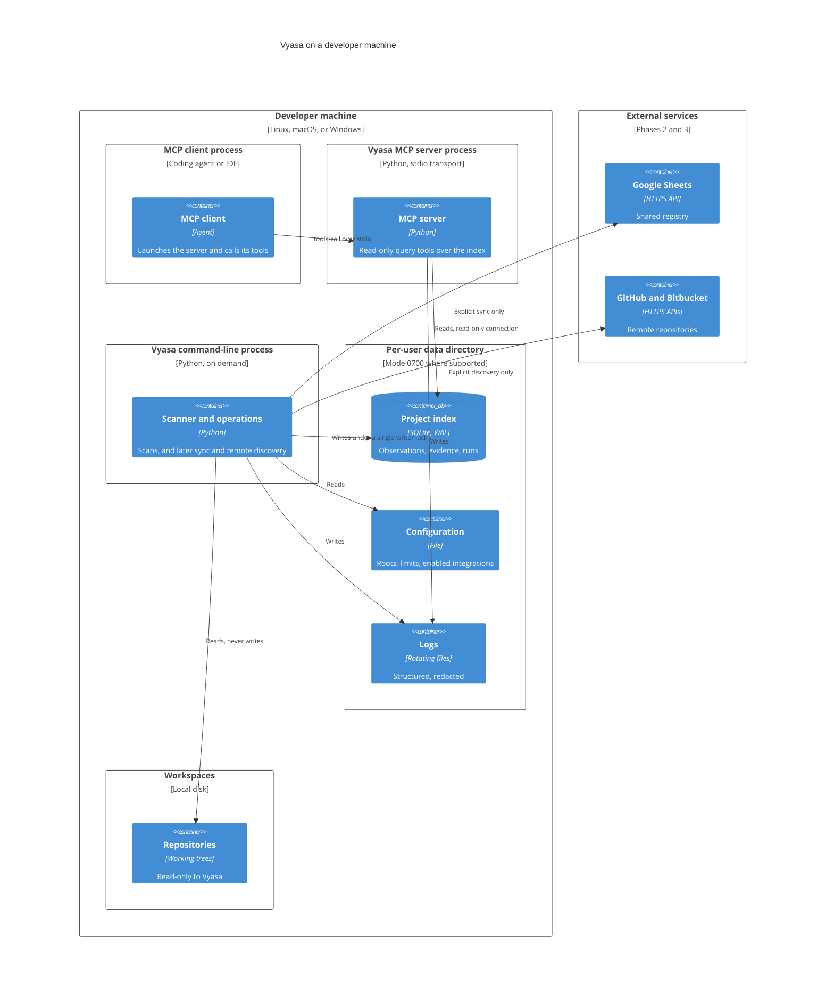

# Question

Where does each part of Vyasa run, and which files and external systems does it touch on one machine?

# Deployment

# What the view fixes

- The server process answers queries only; it opens the index read-only and owns no network connection.
- Anything that writes the index, reads repositories, or talks to the cloud runs in an explicit command process.
- All state lives in one per-user directory outside every scanned repository; only that directory is Vyasa's to write.
- The two processes can run at the same time because the index uses WAL with one writer; the server never blocks the writer.
- Nothing in the cloud box is required for phase 1.

# Related

- [C4 System Views](/architecture/c4-system-views.md)
- [Security Views](/architecture/views/security-views.md)
