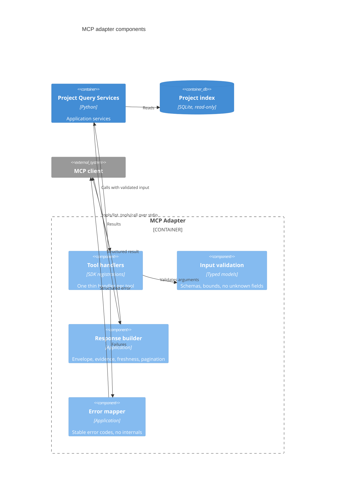
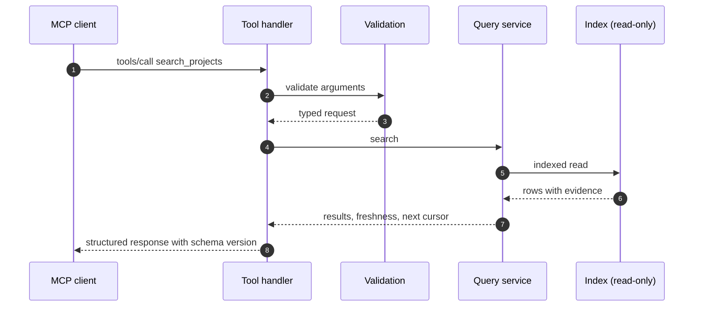
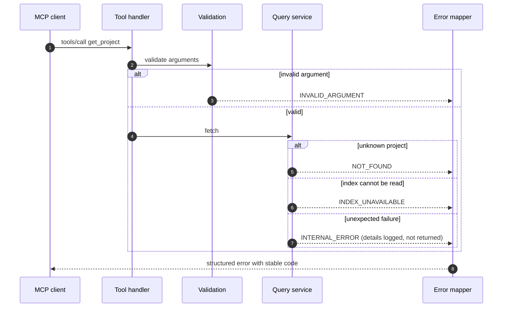

# Question

What is inside the MCP adapter, and what exactly happens to a tool call that succeeds and one that fails?

# Components of the adapter

# A successful call

# A failed call

# What the views fix

- Validation happens before any service or storage call; unknown arguments and path-like values are rejected there.
- Query services and the database connection are read-only, so a tool cannot change repositories or maintained metadata.
- Errors leave the adapter only through the mapper, which strips internals, secrets, and unnecessary absolute paths.
- Log output goes to stderr or files; standard output carries protocol messages only.

# Related

- [MCP Interface](/architecture/mcp-interface.md)
- [C4 System Views](/architecture/c4-system-views.md)
