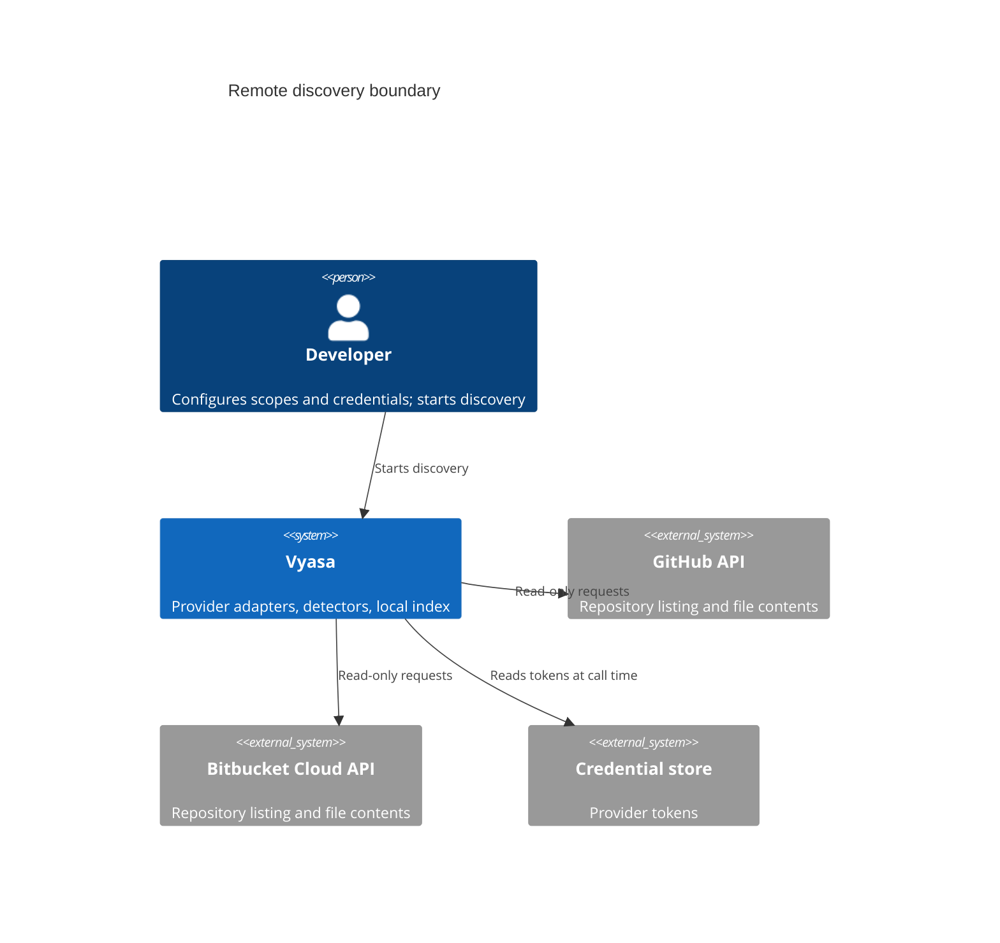
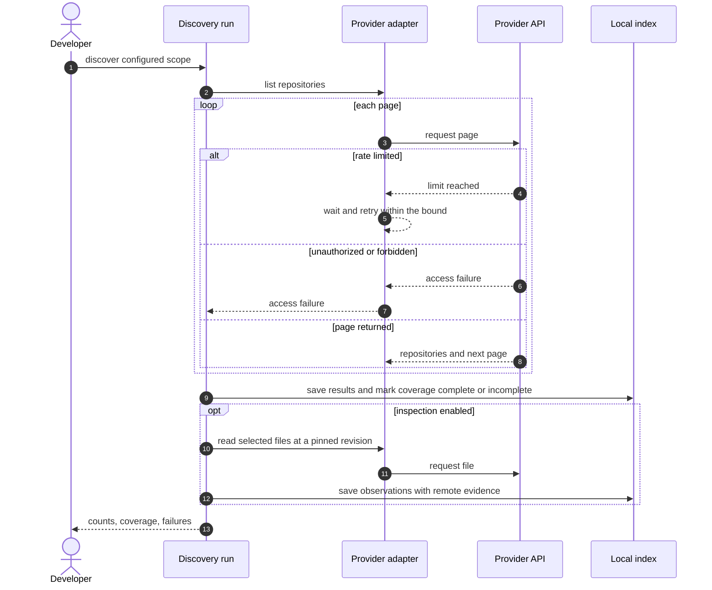
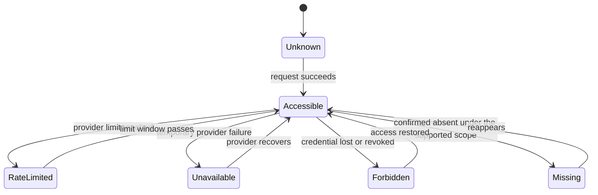
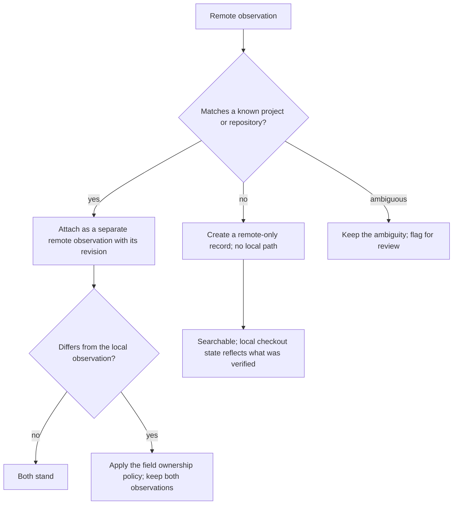

# Question

How are remote repositories listed and read, what can fail, and how do remote facts meet local ones?

# The provider boundary

# One discovery run

Repositories on pages that were not retrieved are never inferred to be absent, and no repository is cloned or checked out.

# Remote access states

These states are never collapsed into a single exists flag, and authorization or partial failures never produce `Missing`.

# Meeting local data

A newer remote observation never overwrites a local working-tree observation, and neither overwrites a shared human-managed field.

# Related

- [Remote Repositories](/architecture/remote-repositories.md)
- [Project Identity](/concepts/project-identity.md)
