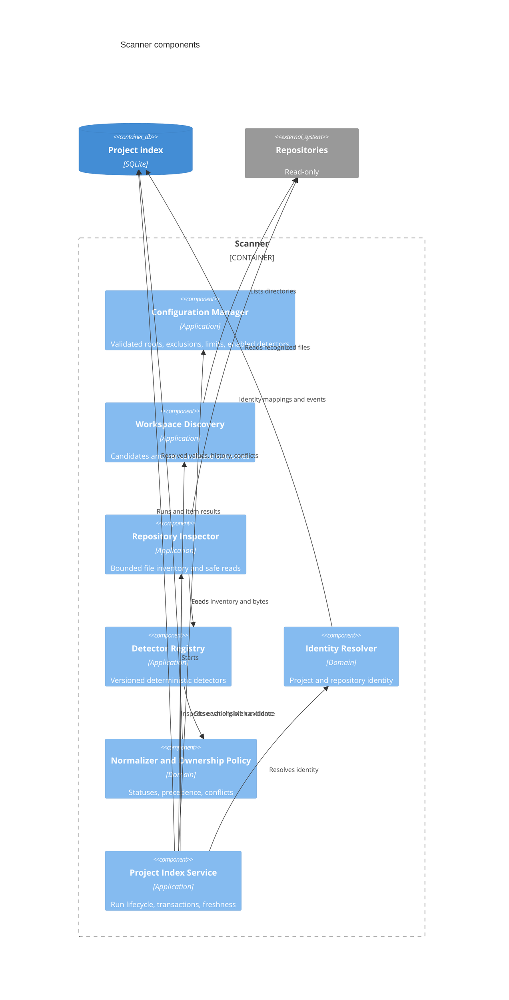
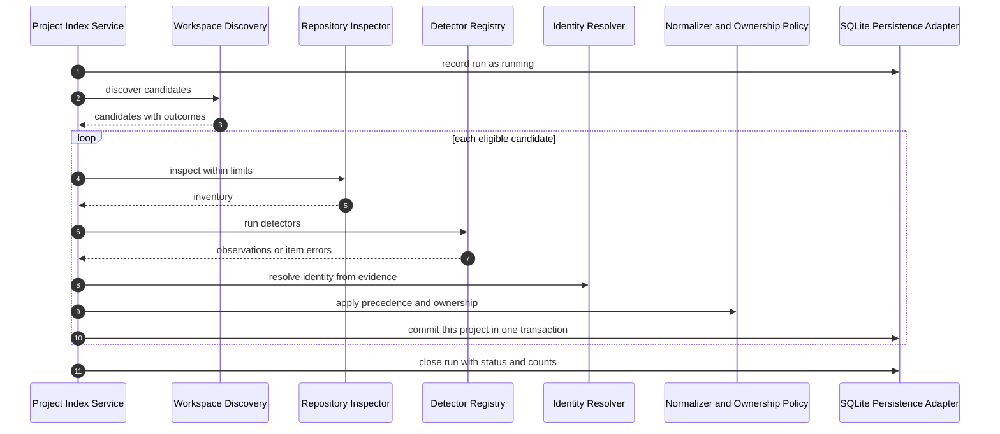
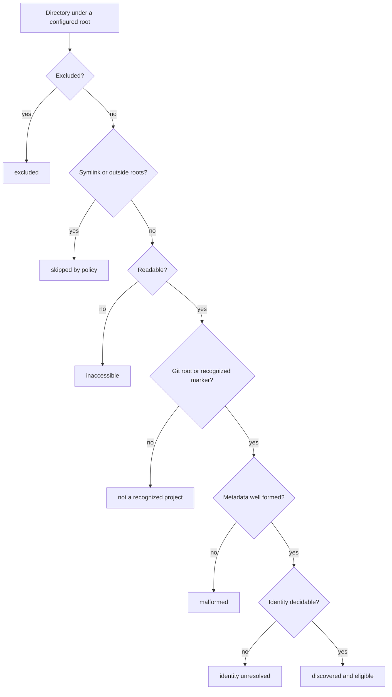
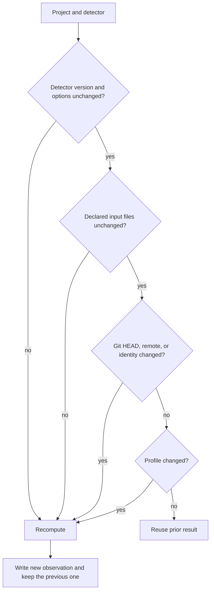

# Question

How do repository files become stored observations, what can go wrong along the way, and when may earlier results be reused?

# Components of the scanner

# One full scan

A failure in one candidate becomes an item result; the loop continues and the run ends `partial`.

# What may a candidate become?

# When may earlier results be reused?

Reuse is never justified by an unchanged timestamp alone when any other invalidation evidence disagrees.

# Related

- [Scanning and Evidence](/architecture/scanning-and-evidence.md)
- [C4 System Views](/architecture/c4-system-views.md)
