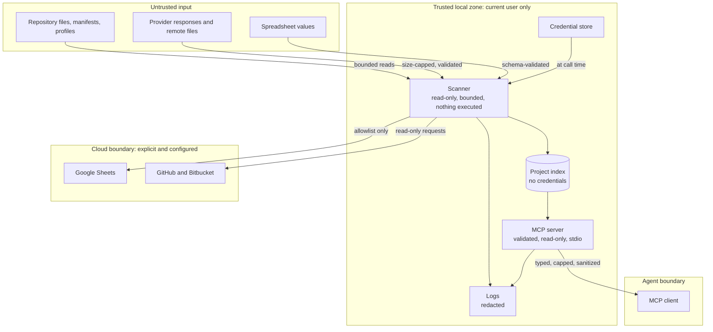
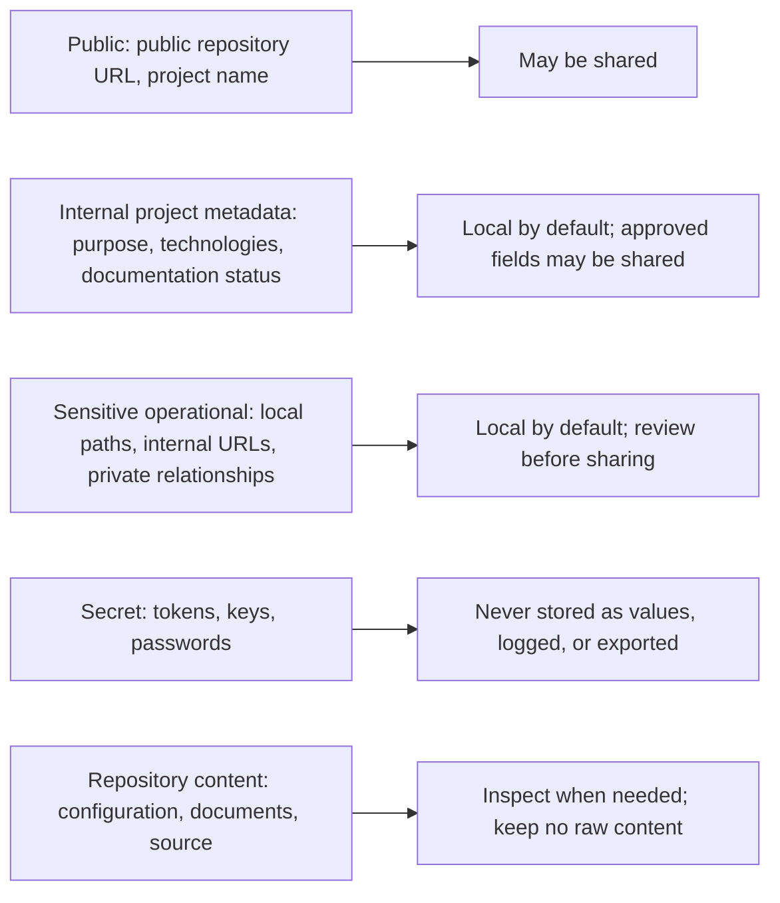
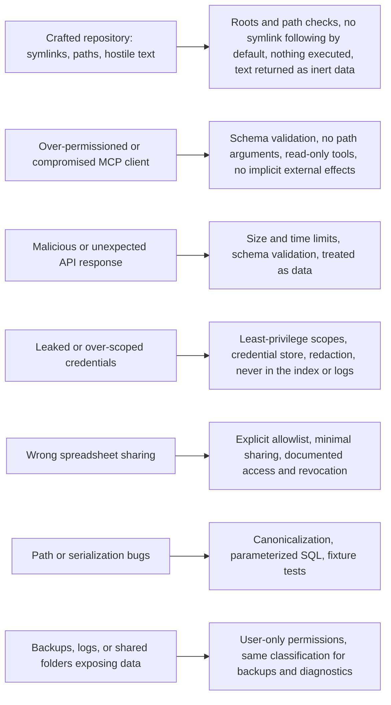

# Question

Which inputs are untrusted, which data may leave the machine, and which control answers each documented threat?

# Trust zones

Everything entering the trusted zone is data. Everything leaving it is allowlisted, minimized, or sanitized. A connection
shown here is permitted only when its phase, configuration, and access policy allow it.

# Data classes and where each may go

# Threats and controls

# Related

- [Security and Privacy](/architecture/security-and-privacy.md)
- [Deployment View](/architecture/views/deployment-view.md)
