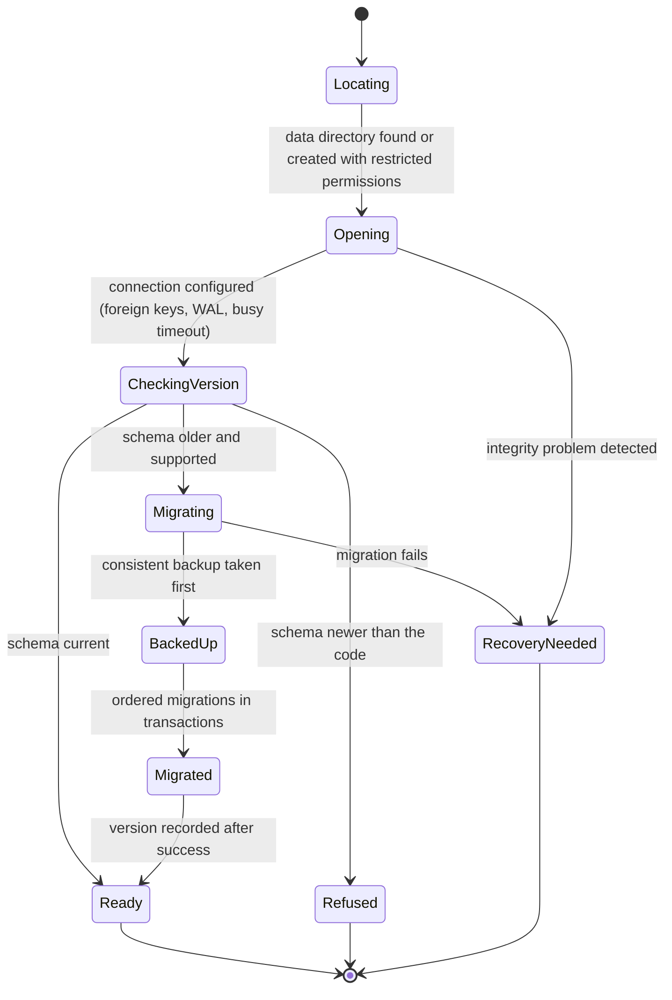
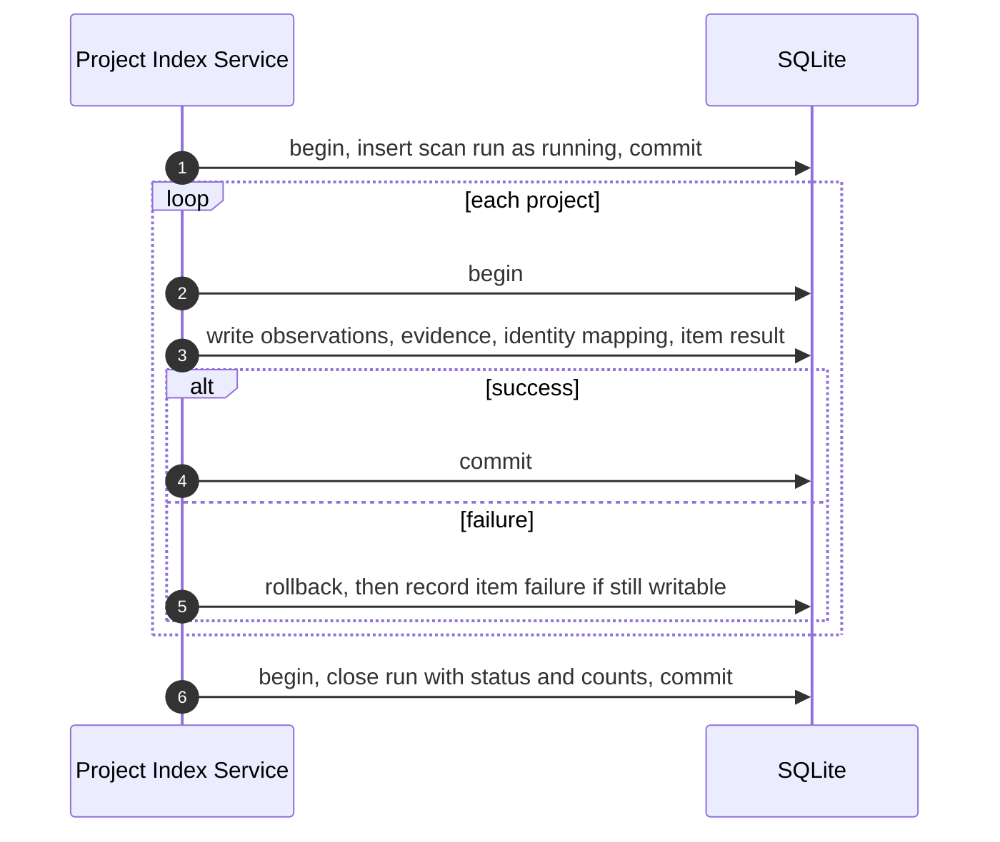
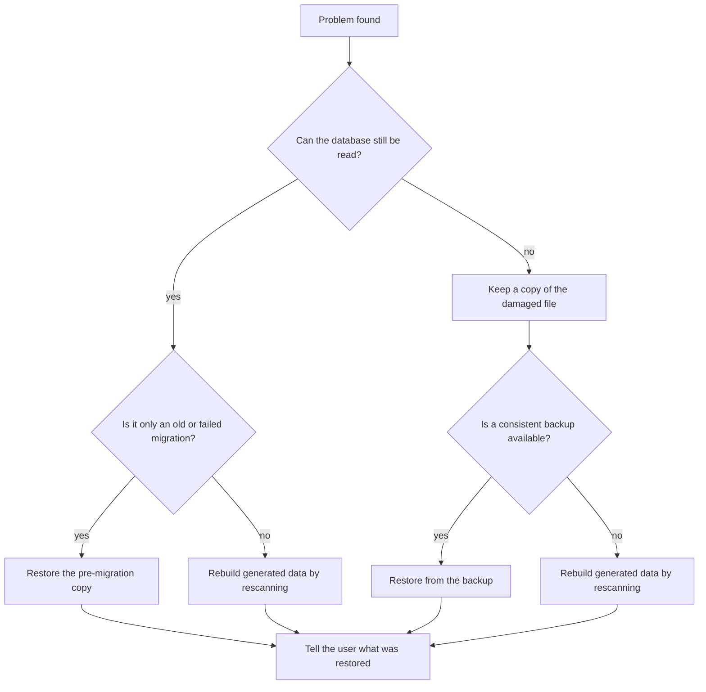

# Question

How does the index stay consistent when Vyasa starts, migrates, writes, crashes, or finds damage?

# Opening the database

A newer schema is refused rather than downgraded, and a failed migration leaves a recoverable copy.

# Writing one scan

Each project commits on its own, so a failure never rolls back earlier projects and incomplete results are never marked current.

# Choosing recovery

Restore returns an earlier state; rebuild recomputes generated data from the repositories. Human-managed shared data is
recovered from the shared registry when available. The user is told which path was taken; a damaged database is never
silently replaced.

# Related

- [Local Storage](/architecture/local-storage.md)
- [Data Model Views](/architecture/views/data-model-views.md)
