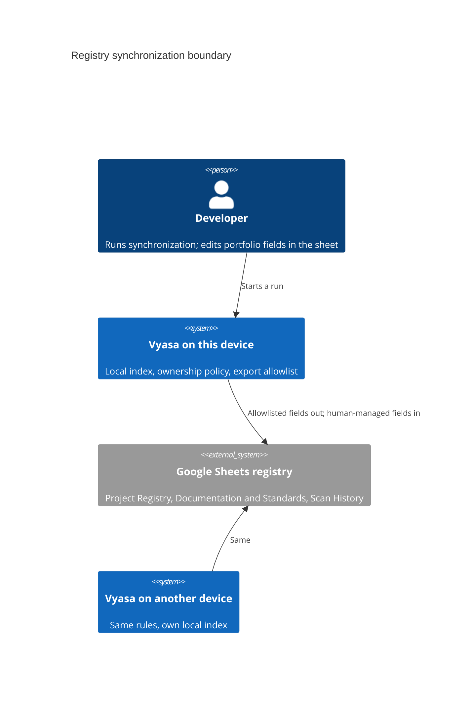
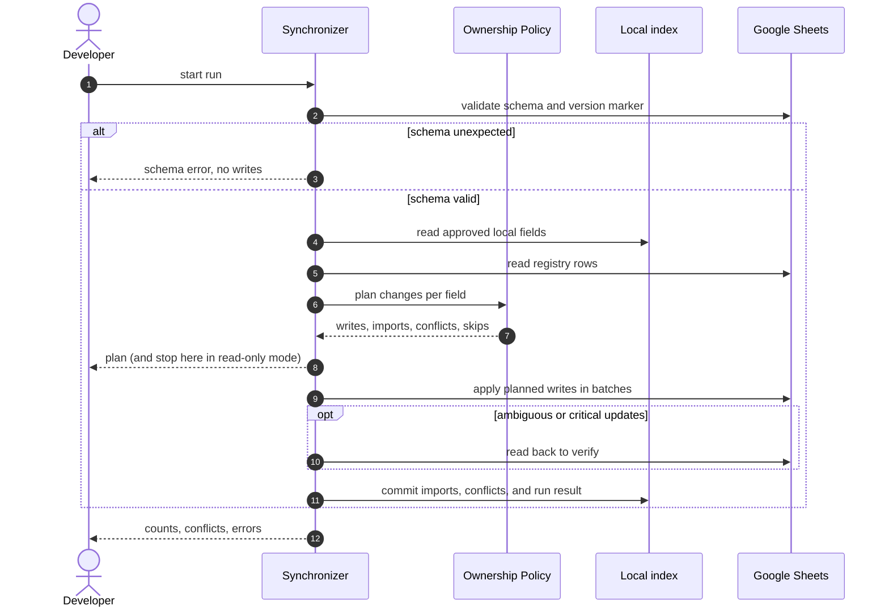
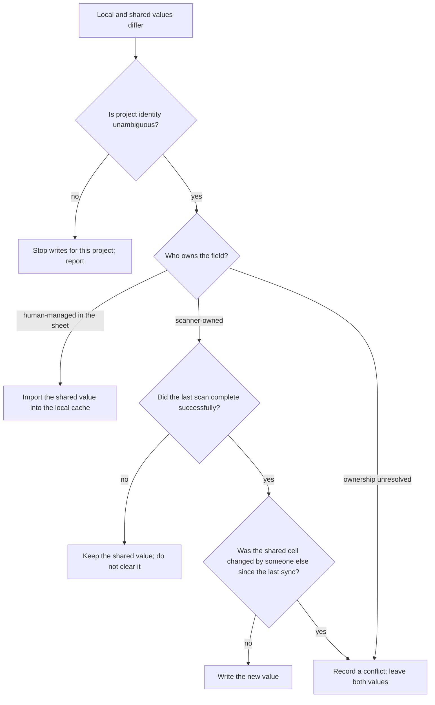
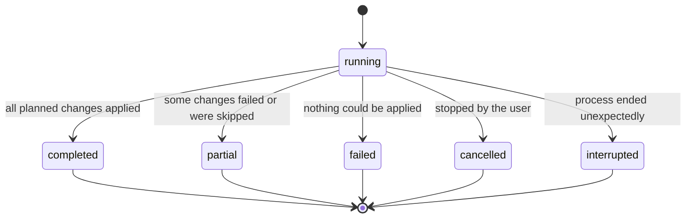

# Question

What crosses the registry boundary, in what order does a run proceed, and how is a difference between local and shared values decided?

# The registry boundary

# One run

# Deciding a difference

Not every difference is a conflict. A newer scanner observation of a scanner-owned field legitimately replaces an older one.
A blank shared value follows its explicit empty-value rule and is never assumed to mean delete. Conflict records hold no
sensitive values.

# Run status

# Related

- [Synchronization](/architecture/synchronization.md)
- [Field Ownership](/concepts/field-ownership.md)
